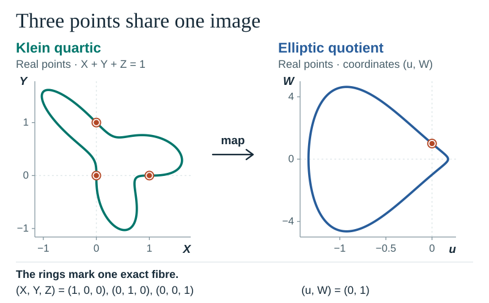

# Crest–Root Calculus

Follow one orange dot on the green curve below. Its two companions move with it. At every instant, all three give the **same point** on the blue curve. Crest–Root Calculus studies connections like this by counting points, finding formulas and checking their predictions exactly.

## What does a degree-three map do?

The green curve is the **Klein quartic**. Its equation has degree four. The blue curve is an **elliptic curve**. The map is a rule that sends each green point to a blue one. The points that land together form a **fibre**. Here a typical fibre has three points, which is what *degree three* counts.

<picture>
  <source media="(max-width: 640px) and (prefers-reduced-motion: reduce)" srcset="docs/figures/still/klein-fibre-mobile.svg" />
  <source media="(prefers-reduced-motion: reduce)" srcset="docs/figures/still/klein-fibre.svg" />
  <source media="(max-width: 640px)" srcset="docs/figures/klein-fibre-mobile.svg" />
  
</picture>

The rings give you a fibre you can check by hand. Put a 1 in any one of the slots in `(X, Y, Z)` and a 0 in the other two. The formula sends each of those three triples to `(u, W) = (0, 1)`. [See the formula and the substitution.](docs/figures/README.md#the-klein-quartic)

## A real example

Suppose we’re given only the equation of another quartic, called **C⋆** (“C-star”). Can we discover a map like the one above? And how can we tell whether we’ve found them all?

Start with arithmetic **modulo 5**, keeping only the remainder after division by 5. Now there are few enough positions to draw every one. A zero means the point lies on the curve. The orange rings show which zeros pass the additional equations for a map.

<picture>
  <source media="(max-width: 640px) and (prefers-reduced-motion: reduce)" srcset="docs/figures/still/cstar-modulo-five-mobile.svg" />
  <source media="(prefers-reduced-motion: reduce)" srcset="docs/figures/still/cstar-modulo-five.svg" />
  <source media="(max-width: 640px)" srcset="docs/figures/cstar-modulo-five-mobile.svg" />
  
</picture>

**Two marks lead to one map.** The two ringed points identify the same quotient in different ways. To prove completeness for C⋆, the program scans a field with 25 elements, where it checks 40 curve points and finds the same two marks. An exact map gives a lower bound of one. The scan and its field bound give an upper bound of one. Together they certify **one geometric quotient class**. Two maps count as the same class if an isomorphism of their target curves turns one map into the other. [Inspect the counts and bounds.](docs/figures/README.md#the-c-star-scan)

### When a candidate disappears

Start with the Fermat quartic, then change two coefficients by multiples of 13. Modulo 13, the change is invisible. All four curves below give the same 16 candidate quotient classes. Read through the powers of 13 to see when the equations first distinguish them.

<picture>
  <source media="(max-width: 640px) and (prefers-reduced-motion: reduce)" srcset="docs/figures/still/lifting-depth-mobile.svg" />
  <source media="(prefers-reduced-motion: reduce)" srcset="docs/figures/still/lifting-depth.svg" />
  <source media="(max-width: 640px)" srcset="docs/figures/lifting-depth-mobile.svg" />
  
</picture>

The last perturbation still has 16 candidates at 2,197. At 28,561 every one fails. An exact map would have to pass at every precision, so that failure rules them all out. On the original Fermat curve, 16 known maps attain the upper bound. [See the four equations and the lifting results.](docs/figures/README.md#the-fermat-lifting-test)

## Where do “crest” and “root” come from?

A **root** in the project’s terminology is a record of point counts, one for each prime of good reduction. A **crest** describes a pattern in how those counts contribute to growth. Here’s an example from the opening sections of the monograph.

A projective line modulo 5 has six points, the five ordinary coordinates and one point called infinity (∞). Choose a point on each of two such lines. Each pair specifies one point on a surface called a **split quadric**. In the real picture, holding either coordinate fixed draws a straight line on the saddle.

<picture>
  <source media="(max-width: 640px) and (prefers-reduced-motion: reduce)" srcset="docs/figures/still/quadric-rulings-mobile.svg" />
  <source media="(prefers-reduced-motion: reduce)" srcset="docs/figures/still/quadric-rulings.svg" />
  <source media="(max-width: 640px)" srcset="docs/figures/quadric-rulings-mobile.svg" />
  
</picture>

For a prime $p$, each line contributes $p+1$ choices, so the count is $(p+1)^2=p^2+2p+1$. The two boundary strips in the grid explain the middle coefficient **2**. For this surface, that same 2 is the growth exponent of the product built from its normalized point counts. [See how the exponent follows from the count.](docs/figures/README.md#the-split-quadric)

## Try it on Windows (beginner instructions)

### 1. Get the files

The illustrations play automatically on this page. For the Python examples, extract the separately distributed `crest_root_calculus_integrated_part_xxx.zip`. Open the extracted folder that contains `crest`. Inside `crest` you should see `scan_completeness_xxx`.

The GitHub ZIP contains this illustrated guide. The Python programs and monograph come with the integrated research archive.

### 2. Install Python

Install **Python 3.12** from [python.org](https://www.python.org/downloads/). During installation on Windows, enable the option to add Python to PATH if it is offered.

Open **PowerShell** or **Git Bash** in the extracted project folder. Check Python:

```bash
python --version
```

If `python` is not recognized on Windows, try `py -3.12` instead of `python` in the steps below.

### 3. Install the needed packages

The Part XXX release was tested with **SymPy 1.14**, plus NumPy for independent point-counting checks. Install them with:

```bash
python -m pip install "sympy==1.14.0" numpy
```

For an isolated setup, you can use a Python virtual environment, but it is not necessary for this first example.

### 4. Run your first exact calculation

From the extracted project folder:

```bash
cd crest/scan_completeness_xxx
python -B decision/decide.py scan/cstar.json --prime 5
```

The result is JSON (structured text). Look for these three fields in the output.

```json
{
  "complete": true,
  "lower": 1,
  "upper": 1
}
```

The matching lower and upper bounds certify that this example has exactly **one** geometric degree-three quotient class.

Want to see an example with none?

```bash
python -B decision/decide.py decision/nonlift_quartic.json --prime 13
```

In this example, the result has `"complete": true`, `"lower": 0`, and `"upper": 0`: no geometric degree-three quotient classes survive the exact lifting check.

### 5. Check the packaged research results

From `crest/scan_completeness_xxx`, run:

```bash
python -B verify_release.py --jobs 3
```

This reruns **18 Part XXX verification groups** and compares their exact outputs against the archived receipt files. Passing means these specified calculations reproduce the stored results on your machine; it does not certify every broader mathematical claim without reading its proof.

If you receive an import error, verify that the packages from step 3 installed into the same Python interpreter you're using here.

## What’s in the research archive?

The integrated research archive is unusually large because it keeps historical work and reproducible evidence instead of only the newest scripts.

| Location | What you'll find |
|---|---|
| `crest/index.html` | The integrated illustrated mathematical monograph, Parts I–XXX, §§1–148. Open it in a browser. |
| `crest/scan_completeness_xxx/` | The most recent equation-only discovery, lifting, decision, and verification programs. |
| `crest/README_PART_XXX.md` | Detailed commands for the newest release. |
| `crest/pointfree_xxix/` | Earlier point-free discovery experiments and checks. |
| `crest/exhaustion_xxviii/` | Earlier geometric classification and exclusion experiments. |
| `crest/scan_completeness_xxx/part_xxx.pdf` | Standalone research paper for §§138–148. |
| Archived JSON receipt files | Expected exact outputs used to check reproducibility. |

> **Note:** In the present archive, the Part XXX quick-start file is `crest/README_PART_XXX.md`. Historical directories contain additional specialized READMEs.

## What is proved, and what remains difficult?

The Part XXX work provides a **theoretical terminating decision procedure for geometric degree-three quotient classes of smooth plane quartics over the rationals**, together with concrete certificates for worked examples. However, the finite fields and lifting precision required by the general procedure can become impractically large. A prior twelve-chart elimination procedure also exceeded 1,600 seconds on representative inputs. The fast examples above are not a promise of fast performance on arbitrary curves.

There is also an important distinction between a genus-one quotient **defined over** the rationals and one that has a **rational point**. The latter question is not automatically resolved by discovering its quotient class.

## How can I help?

Beginners can help by reproducing the examples on different computers, filing clear bug reports, improving the installation guide, or making the outputs easier to understand. More experienced contributors can work on runtime improvements, independent implementations, algebraic proof checks, test coverage, and new examples.

When reporting a problem, include the command you ran, the Python version, your operating system, and the exact error message. Avoid posting claims of new mathematical theorems without precise statements and reproducible verification steps.

## Research and citation

The primary technical reference is `crest/index.html`, the integrated monograph through **Part XXX (§148)**. For claims from a particular experiment, consult its corresponding section, script, and receipt. A formal bibliographic citation, contributor list, release DOI, and software license should be added before a public archival release; none are assumed here.

**Project status:** Active research software. Results and evidence have different levels of verification; consult the proof and receipt associated with each claim.
