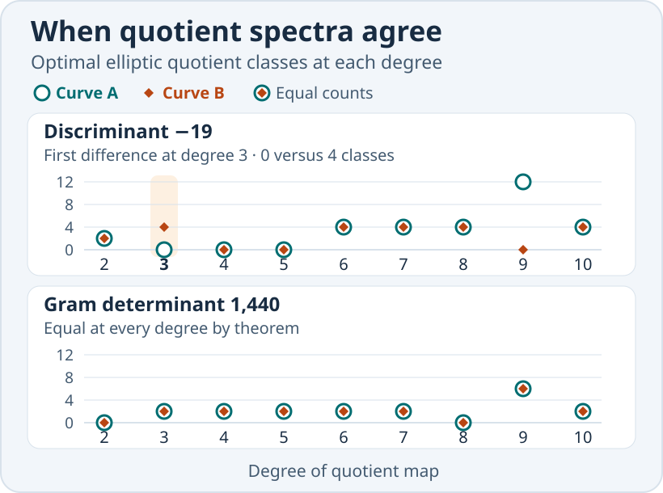
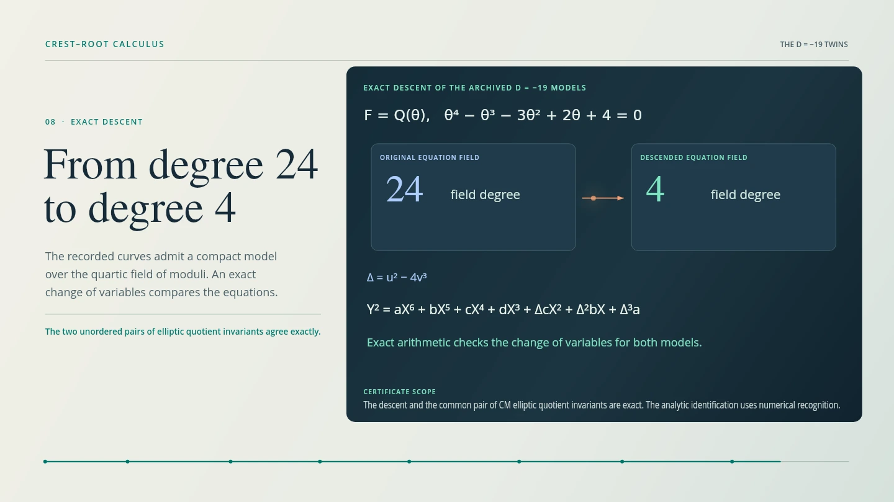

# Crest–Root Calculus

**Find the simpler curves hidden inside an equation, write down the maps to them, and prove when the list is complete.**

A **quotient map** sends several points on one curve to the same point on a simpler curve. Its **degree** is the number of source points above a typical target point. Crest–Root uses exact arithmetic to discover these maps, verify them by substitution, and count them under stated hypotheses. The project began with a question about counting points modulo primes. It now also asks **which features of the whole curve those counts can recover**.

[What you can compute](#what-you-can-compute) · [Research results](#what-the-quotient-counts-reveal) · [Run the verifiers](#run-the-verifiers) · [Visual companion](docs/visuals/README.md) · [Illustrated monograph](https://towre676-cloud.github.io/crest-root-calculus/)

<picture>
  <source media="(max-width: 640px) and (prefers-reduced-motion: reduce)" srcset="docs/figures/still/klein-fibre-mobile.svg" />
  <source media="(prefers-reduced-motion: reduce)" srcset="docs/figures/still/klein-fibre.svg" />
  <source media="(max-width: 640px)" srcset="docs/figures/klein-fibre-mobile.svg" />
  
</picture>

On the Klein quartic, cycling the three coordinates moves among three points with the same elliptic image. This is a **degree-three** quotient. The three marked vertices give a fibre you can check by hand. [Formula and exact identity](docs/figures/README.md#the-klein-quartic) · [Runnable fibre example](examples/fibres/README.md)

## What you can compute

| Start with | What the program can certify | Solver and proof |
| --- | --- | --- |
| **One hyperelliptic equation** | Every rational degree-two quotient to a positive-genus curve, including quotients with arbitrary infinity fibres. For odd-degree models the coefficient solver also recovers unknown hyperelliptic targets in higher degrees, with a degree cap for elliptic targets. | [Coefficient-only discovery](research/coefficient-quotients/README.md) · [General fibres](research/cyclic-cover-reconstruction/arbitrary-fibres.md) |
| **One cyclic-cover equation** | All maps in the stated equivariant class, allowing mixed branching on both curves, arbitrary infinity fibres and smaller target exponents. The derivative recurrence reconstructs map coefficients in that search. | [Cyclic reconstruction](research/cyclic-cover-reconstruction/README.md) · [Arbitrary fibres and completeness](research/cyclic-cover-reconstruction/arbitrary-fibres.md) |
| **Two smooth hyperelliptic equations** | Every nonconstant rational map to the supplied target when it has genus at least two. The target genus gives a finite degree bound. An elliptic-target theorem covers maps with a singleton infinity fibre. | [Finite map reconstruction](research/bounded-correspondences/README.md) |
| **An elliptically split genus-two Jacobian** | Complete geometric degree spectra for specified CM and non-CM gluing families. For non-CM cyclic cubics of genus two, the spectrum also gives every multiplicity and there is an exact test for rational descent. | [CM spectra](research/elliptic-quotients/cm-spectra/README.md) · [Non-CM gluings](research/elliptic-quotients/isotypic-gluing/README.md) · [Cyclic cubic law](research/elliptic-quotients/bielliptic-reconstruction/cubic-genus-two.md) |
| **A split genus-two reduction with geometrically distinct elliptic factors** | Torsion certificates determine the full optimal degree over the prime field, including its residue-characteristic part. A separate exact replay determines the characteristic-zero minima for all 69 Richelot neighbours in the study. | [Degree certificates and family sweep](research/torsion-denominators/README.md) |
| **A proposed complete list of elliptic quotients** | Exact Néron–Severi lattices for twelve split examples, a separate nine-model bounded period search, and a quaternionic case certified to have no elliptic quotient in any degree. | [Certificate framework](research/elliptic-quotients/RECONSTRUCTION-THEOREM.md) · [Certified periods and lattice enumeration](research/elliptic-quotients/rigorous-search/README.md) |

### How a candidate becomes a proof

Arithmetic modulo a prime can give a finite list of candidates. More precision can eliminate candidates, while an explicit formula checked by substitution proves existence. On the quartic **C⋆**, the field with 25 elements bounds the number of geometric degree-three classes by one, and an exact formula attains the bound. For the perturbed Fermat quartic shown beside it, all 16 candidates disappear at the next precision. [Counts and equations](docs/figures/origins.md#when-the-bounds-meet)

<picture>
  <source media="(max-width: 640px) and (prefers-reduced-motion: reduce)" srcset="docs/figures/still/proof-bounds-mobile.svg" />
  <source media="(prefers-reduced-motion: reduce)" srcset="docs/figures/still/proof-bounds.svg" />
  <source media="(max-width: 640px)" srcset="docs/figures/proof-bounds-mobile.svg" />
  
</picture>

## What the quotient counts reveal

The **elliptic quotient spectrum** counts optimal elliptic maps degree by degree. An optimal map does not factor through a smaller elliptic map followed by an isogeny. Maps related by an isomorphism of their targets count as one class. A **geometric** count allows the coefficients of the maps to lie in an algebraic closure.

| Data that agree | What the exact calculations show |
| --- | --- |
| **Rational polarized isogeny data** | Two genus-two Jacobians built from the same elliptic square have the same rational polarized Tate data over a common field and the same Frobenius polynomials at good places there. Changing the two-torsion gluing gives **0 versus 8** classes in degree three and a **3:4** ratio of leading counting constants. The finite-kernel formula explains this change for polarized varieties isogenous to CM elliptic powers, including nontrivial ideal class groups. [Counting theorem and replay](research/elliptic-quotients/cm-spectra/README.md) |
| **Every quotient count in degrees prime to three** | A level-three opposite-secant construction gives **31 certified pairs** from the class-number-one census, each with exact equations and identified integral lattices. The discriminant −19 pair first differs at degree **3**, a −43 pair at **6**, a −67 pair at **9**, and a −163 pair at **21**. An infinite family has arbitrarily late first differences, even in a fixed CM field as the conductor varies. [Equations and certificates](research/elliptic-quotients/twin-curves/README.md) · [Unbounded first differences](research/elliptic-quotients/opposite-secant-spectra/README.md#an-infinite-family-with-an-unbounded-first-difference) |
| **Every quotient count in every degree** | The smallest pair in the full-spectrum census has inequivalent refined Humbert forms of Gram determinant **1,440**. Both genus-two curves have explicit sextics over degree-eight fields. Their degree-16 models carry two exact degree-three covers each, and the lattice certificate checks all 16 embeddings. The broader infinite family has uniform determinantal equations. [Equations, descent and certificates](research/elliptic-quotients/full-spectrum-curves/README.md) · [Uniform family construction](research/elliptic-quotients/full-spectrum-curves/family-equations.md) |

[](docs/visuals/README.md#quotient-spectrum-comparison)

The exact opposite-secant sweep through child Gram determinant **200,000** found **280 full-spectrum equalities among 289,274 eligible lattice pairs**. Neighbour isometries certify 159. Explicit sublattice isometries now give geometric proofs for **all 108 local square-class exclusions**, covering 90 cases at two and 18 at five. The other 13 use exact Hecke decompositions with eight certified twisted central zeros. [Census and bounds](research/elliptic-quotients/opposite-secant-spectra/delay/README.md#extension-through-child-determinant-200000) · [Geometric proofs](research/elliptic-quotients/opposite-secant-spectra/delay/local-geometry.md) · [Hecke certificates](research/elliptic-quotients/opposite-secant-spectra/delay/residual-packets.md)

[](docs/visuals/README.md)

The discriminant −19 exhibit follows the construction from the lattice to the branch points and back from the equation to the lattice certificate. [Download the autoplay exhibits](docs/visuals/README.md)

### Open questions

The program still seeks a uniform criterion for full-spectrum equality beyond the census, expanded sextics for the positive parameters in the determinantal family, and a general reconstruction theorem recovering characteristic-zero maps from local information with suitable extra data. Published benchmarks compare specific solver tasks and inputs. A broad performance comparison and literature-priority questions remain open. [Research register](research/backlog-2026-11-23.md#current-research-avenues) · [Solver comparisons](research/solver-comparison/README.md) · [Obstruction from all-prime point counts](research/local-pattern-obstruction/README.md)

## Run the verifiers

From the repository root with Python 3.11 or newer. On Windows, use `py` in place of `python` if that is how you start Python.

```sh
python -m pip install sympy
python -B research/elliptic-quotients/cm-spectra/verify.py
python -B research/replay.py --quotients-only
```

The first run checks four exact degree-two maps on the two genus-two models. It also compares a Gaussian divisor formula, direct enumeration and exact lattice counts, agreeing on **11,574 classes at 94 distinct degrees** through degree 150. The second run checks seven groups, including arbitrary-fibre cyclic reconstruction and the non-CM genus-two cubic spectrum. [CM verifier and data](research/elliptic-quotients/cm-spectra/README.md) · [Period and number-field verifiers with additional dependencies](research/elliptic-quotients/rigorous-search/README.md)

## How the project began

Two equations each have **five** solutions on a clock with five positions. On a clock with 25 positions the parabola has **25** solutions and the cusp has **45**. All 20 extra solutions come from the refinements of the single point at the cusp's tip. [Check a dot by hand](docs/figures/origins.md#two-clocks-two-curves)

<picture>
  <source media="(max-width: 640px) and (prefers-reduced-motion: reduce)" srcset="docs/figures/still/cusp-lifts-mobile.svg" />
  <source media="(prefers-reduced-motion: reduce)" srcset="docs/figures/still/cusp-lifts.svg" />
  <source media="(max-width: 640px)" srcset="docs/figures/cusp-lifts-mobile.svg" />
  
</picture>

A later experiment plotted an elliptic-curve score against a contribution already included in that score. Removing the contribution exposed how little of the apparent relation was independent evidence. The original claim was withdrawn and the remaining variation became a separate question. [The 201-curve audit and data](docs/figures/origins.md#checking-the-apparent-law)

<picture>
  <source media="(max-width: 640px) and (prefers-reduced-motion: reduce)" srcset="docs/figures/still/lowest-zero-audit-mobile.svg" />
  <source media="(prefers-reduced-motion: reduce)" srcset="docs/figures/still/lowest-zero-audit.svg" />
  <source media="(max-width: 640px)" srcset="docs/figures/lowest-zero-audit-mobile.svg" />
  
</picture>

[All nine mathematical illustrations](docs/figures/README.md) · [Offline workbook](examples/workbook.html) · [Beginner introduction (PDF)](downloads/crest-root-introduction.pdf)

## Examples and applications

| Explore | What you can try |
| --- | --- |
| [Four worked examples](examples/workbook.html) | Follow a fibre, count and index an 80-slot lantern puzzle, test a deceptive pair, or audit a score that shares terms with its predictor. |
| [Linkwright](linkwright/README.md) | Check four-bar linkage closure and continuous motion using its configuration curve. |
| [Spectral mixtures and solar export](research/configuration-and-certificates/README.md) | See how model assumptions affect a mineral-mixture inference or a feeder export limit. |
| [Tillamook crossing](research/deployable-crossing/v3/README.md) | Explore a feasibility study linking a mapped site to a structural and deployment model for a proposed pedestrian crossing. |
| [Offline application workshop](applications/README.md) | Run seven interactive examples, including measurement, battery screening and degree-three map discovery. [Download ZIP](downloads/crest-root-applications.zip) |

## Papers and source

- [Elliptic Quotient Spectra under Complex Multiplication (PDF)](downloads/Crest-Root-Elliptic-Quotient-Spectra.pdf) · [TeX source](research/elliptic-quotients/cm-spectra/paper.tex)
- [Cyclic Quotient Reconstruction (PDF)](downloads/Crest-Root-Cyclic-Quotient-Reconstruction.pdf) · [Proof and benchmarks](research/cyclic-cover-reconstruction/README.md)
- [What Is Crest–Root Calculus? (PDF)](downloads/crest-root-introduction.pdf) · [Illustrated monograph](https://towre676-cloud.github.io/crest-root-calculus/)
- [Research index](research/README.md) · [Research register](research/backlog-2026-11-23.md) · [Repository ZIP](https://github.com/towre676-cloud/crest-root-calculus/archive/refs/heads/main.zip)
