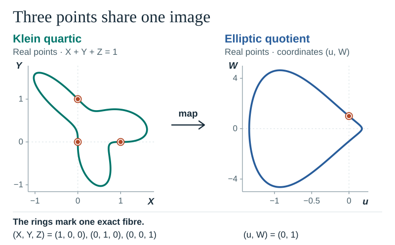

# Crest–Root Calculus

**Find the simpler curves hidden inside a complicated equation, and prove which ones are there.**

A quotient map sends several points of one curve to the same point of a simpler curve. Its **degree** is the number of source points above a typical target point. Crest–Root builds exact tools to find these maps, verify their formulas, and determine when the list is complete. It grew from experiments with point counts into a program about what those counts reveal and what extra information a proof needs.

[Download the research paper (PDF)](downloads/Crest-Root-Elliptic-Quotient-Spectra.pdf) · [Read the introduction](downloads/crest-root-introduction.pdf) · [Explore the illustrated monograph](https://towre676-cloud.github.io/crest-root-calculus/)

## Why the degree spectrum matters

A curve can have several fundamentally different maps to elliptic curves. An **optimal** map cannot be obtained by following another elliptic map with a further isogeny. The spectrum records the degrees of the optimal maps and how many classes occur at each degree.

Two genus-two Jacobians in the paper come from the **same elliptic square**, with the same pulled-back polarization. Over a common field, they have the same rational Tate modules with their pairings and the same Frobenius polynomials at good places. The way their two-torsion points are identified changes the answers.

| What we count | First curve | Second curve |
|---|---:|---:|
| Optimal classes of degree three | 0 | 8 |
| Ratio of leading coefficients for the count through degree $X$ | 3 | 4 |

The calculation explains the difference. A direction in the common elliptic square has a degree given by a quadratic norm. The finite subgroup identified by the quotient can divide that degree. Changing the subgroup changes which directions receive the division. The theorem computes this correction for polarized varieties isogenous to CM elliptic powers, in every dimension $r\ge 2$, including fields with nontrivial ideal class group. [Theorem and exact replay](research/elliptic-quotients/cm-spectra/README.md)

## What you can compute

| Task | Proven coverage | Start here |
|---|---|---|
| Find a quotient from an equation | All rational degree-two quotients to positive genus. For cyclic covers, specified equivariant classes with mixed branch multiplicities, smaller target exponents, and branch-supported finite poles. | [Coefficient-only search](research/coefficient-quotients/README.md) · [Cyclic cover search](research/cyclic-cover-reconstruction/README.md) |
| Find maps to a given curve | All nonconstant rational maps between the supplied smooth hyperelliptic models when the target has genus at least two. There is a separate theorem for elliptic targets with a singleton infinity fibre. | [Finite map reconstruction](research/bounded-correspondences/README.md) |
| Determine elliptic degrees with repeated factors | All geometric optimal degrees for the stated non-CM gluing families. A CM counting theorem and a closed multiplicity formula for every degree in the non-product $j=1728$ two-torsion gluing. | [Non-CM families](research/elliptic-quotients/isotypic-gluing/README.md) · [CM spectra](research/elliptic-quotients/cm-spectra/README.md) |
| Prove that a list of elliptic quotients is complete | Exact Néron–Severi lattices for twelve split examples, with a separate nine-model bounded period-and-lattice replay. A certified quaternionic example has no elliptic quotient in any degree. | [Certificate framework](research/elliptic-quotients/RECONSTRUCTION-THEOREM.md) · [Bounded period replay](research/elliptic-quotients/rigorous-search/README.md) |

The programs use complementary checks. An exact substitution proves that a proposed map exists. Exhaustive enumeration or an integral lattice certificate can prove that every allowed map has been accounted for. The period replay uses certified algebraic maps or correspondences and rank bounds. Each solver documents the hypotheses that let it give a complete answer. [Research index and comparisons](research/README.md)

## Run the mathematics

From the repository root with Python 3.11 or newer:

~~~sh
python -m pip install sympy
python -B research/elliptic-quotients/cm-spectra/verify.py
~~~

This checks the four degree-two formulas on the two genus-two models. It also compares the Gaussian divisor formula, direct enumeration and both exact lattice spectra through degree 150. The three routes give **11,574 classes at 94 distinct degrees**.

~~~sh
python -B research/replay.py --quotients-only
~~~

This runs the coefficient-only replays, including the finite-pole cyclic search. The [certified period replay](research/elliptic-quotients/rigorous-search/README.md) uses `python-flint` and `cypari2` in addition to SymPy. For Windows, use `py` in place of `python` if that is how you start Python.

## Explore the ideas

Start with the [illustrated origins](docs/figures/origins.md). Two curves have the same number of solutions on a clock with five positions. On a clock with 25 positions their counts separate, and one place in the equation explains the difference. The move from local observations to a global explanation is the thread through this project.

| Try this | What it teaches |
|---|---|
| [Find one fibre on a curve](examples/fibres/README.md) | Follow several source points to one target point. |
| [Design a lantern puzzle](examples/lanterns/README.md) | Count every valid pattern and jump straight to one by number. |
| [Test a solver against a deceptive pair](examples/solver-tests/README.md) | See what can go wrong when two cases agree on every check tried so far. |
| [Audit a score](examples/scores/README.md) | Remove a shared ingredient and see which comparisons survive. |

[Open the offline workbook](examples/workbook.html) · [Download the repository ZIP](https://github.com/towre676-cloud/crest-root-calculus/archive/refs/heads/main.zip)

## Applications

The same approach is useful whenever a measurement, simulation or sample leaves a gap between the evidence and the decision.

- [Linkwright](linkwright/README.md) uses a configuration curve and continuous motion checks for linkages.
- [Spectral mixtures and solar export](research/configuration-and-certificates/README.md) show how model assumptions change an inference about a measured powder or a limit on a feeder.
- [Tillamook crossing](research/deployable-crossing/v3/README.md) connects a mapped site to one structural and deployment model for a proposed pedestrian crossing. It is a feasibility study.
- [The offline workshop](applications/README.md) includes seven interactive examples, from measurement and battery screening to finding a degree-three map. [Download the workshop](https://raw.githubusercontent.com/towre676-cloud/crest-root-calculus/main/downloads/crest-root-applications.zip)

## Papers and reproducibility

- [Elliptic Quotient Spectra under Complex Multiplication (PDF)](downloads/Crest-Root-Elliptic-Quotient-Spectra.pdf) · [TeX source](research/elliptic-quotients/cm-spectra/paper.tex)
- [Cyclic Quotient Reconstruction (PDF)](downloads/Crest-Root-Cyclic-Quotient-Reconstruction.pdf) · [Cyclic benchmarks and proof](research/cyclic-cover-reconstruction/README.md)
- [What Is Crest–Root Calculus? (PDF)](downloads/crest-root-introduction.pdf) · [Illustrated monograph](https://towre676-cloud.github.io/crest-root-calculus/)
- [Research index](research/README.md) · [Open questions](research/backlog-2026-11-23.md)
