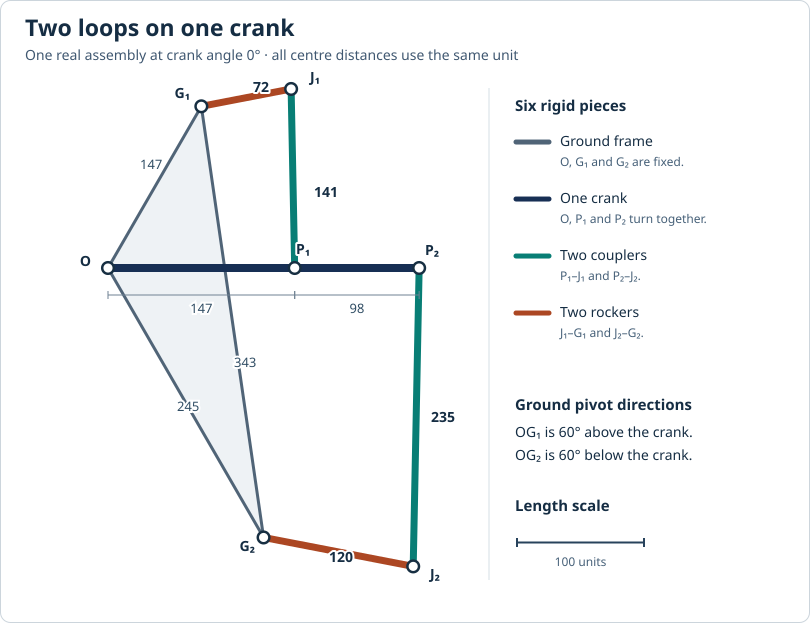
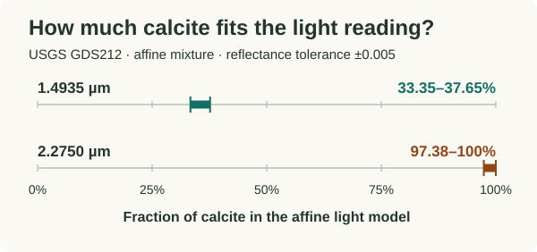
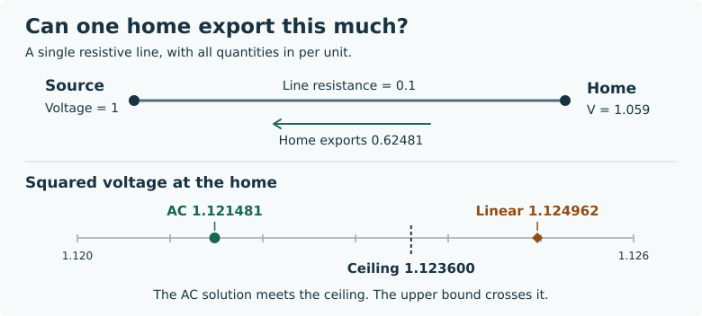

# Crest–Root Calculus

**How much can a small calculation tell us about a whole shape?** This project started with that ambition and grew into programs that can find hidden maps between curves. You can follow the story here with just counting, multiplication, and a little clock arithmetic.

[Open the seven applications](#seven-applications-you-can-run) · [Choose a worked example](#choose-a-worked-example) · [Try the wing, rock and solar experiments](#a-wing-a-rock-and-a-street-of-solar-roofs) · [How it began](#how-the-project-began) · [Why a claim changed](#when-a-pattern-looks-too-good) · [Finding a hidden curve](#turning-the-question-around) · [Run the examples](#try-it-on-windows-beginner-instructions)

[Read the nine-page introductory essay](downloads/crest-root-introduction.pdf) · [Read the full illustrated monograph, Parts I–XXX](https://towre676-cloud.github.io/crest-root-calculus/) · [See all 57 research questions and their status](research/backlog-2026-11-23.md)

## Seven applications you can run

**Try a real decision.** Can a second reading settle a chip’s width? Which street still needs a leak search? Does a retired battery need another test? The workshop also compares home retrofits, reconstructs material structures, schedules telescope observations, and runs the original degree-three map solver on published curves. Each app accepts your own inputs and shows which conclusions the measurements support.

On Windows, extract the ZIP and double-click **Start-Workshop.cmd** with Python 3.11 or newer installed. [Download the offline workshop](https://raw.githubusercontent.com/towre676-cloud/crest-root-calculus/main/downloads/crest-root-applications.zip) · [Browse the seven applications and their measured results](applications/README.md)

## Choose a worked example

Start with a decision you want to make. Each example gives you a working program, a result you can check by hand, and something you can change.

| What are you trying to do? | Start here | Make it your own |
|---|---|---|
| Design enough different puzzles for a class or a fair | [Build a lantern strip](examples/lanterns/README.md) | Change the length, colors, or neighbor rule. Ask for a playable row by number. |
| Find all the points on a complicated curve above one simpler point | [Hunt for three points on C⋆](examples/fibres/README.md) | Give the program a rational target. See which of its source points have rational coordinates. |
| Find out whether a math program declares victory too early | [Try to fool a solver](examples/solver-tests/README.md) | Choose how long two inputs agree. Run your solver on both and compare its answers. |
| Decide what a score really rewards | [Award the exploration badge](examples/scores/README.md) | Supply your own CSV and scoring weight. See who moves up when the shared ingredient comes out. |

**Try the four experiments in your browser.** Download and extract the ZIP, then double-click `examples/workbook.html`. Change a rule or a number and the answer updates. The workbook runs offline. The Python guides above take you from each example to your own inputs. [Download the workbook and programs (.zip).](https://github.com/towre676-cloud/crest-root-calculus/archive/refs/heads/main.zip)

## A wing, a rock and a street of solar roofs

**Build the Linkwright reference wing.** The fabrication kit includes life-size drawings for US Letter and A4, a 39-solid 3D assembly, CAD cutting files, and a bench form for measuring your finished linkage. Extract the ZIP and open `index.html` to use it offline. [Download Linkwright](https://raw.githubusercontent.com/towre676-cloud/crest-root-calculus/main/downloads/linkwright-implementation-kit.zip) · [Read the mechanical build guide](linkwright/README.md)

**Start with the wing.** Imagine turning a crank half a degree at a time. Every picture shows four bars joined together. Could the crank still jam *between* pictures? Yes. In one design the bars fall short by just **0.00006 mm** in an interval that all 720 pictures miss. The two extreme distances between the pins tell you whether *every* angle works. [See the two poses and the missing interval](research/configuration-and-certificates/mechanisms/README.md)


**Give one crank two jobs.** Attach two pairs of bars to the same crank. Its possible poses form a shape mathematicians call a *configuration curve*. In the six-bar drawing, all the bar lengths are whole numbers. A symmetry lets us group points of the mathematical curve in threes and send each group to one point of a simpler curve. The formula uses complex numbers. [See the mechanism, the formula and a second design where grouping in threes is impossible](research/configuration-and-certificates/sixbar/README.md)



**Can light tell us how much calcite is in a rock?** A lab weighed out **80% calcite and 20% clay**. In a simple model of the reflected light, one wavelength allows 33–38% calcite and another requires at least 97%. No number works for both. With a model that accounts for grains scattering light, the amount of surface the light sees can change while the mass stays the same. The reference grain sizes matter. [Work through the weighed powder](research/configuration-and-certificates/spectra/README.md)



**How much solar power could 18 homes send out together?** On the example network, **2.71964 kW per new home** passes an upper-voltage check across a whole range of conditions. Every home can be at its cap at once. A conservative check can also turn down an offer that would work. The drawing shows the exact voltage, the limit, and the higher prediction in a tiny network you can check by hand. [Explore the voltage proof and its assumptions](research/configuration-and-certificates/power/README.md)



[Read the two research Parts and replay all four checks](research/configuration-and-certificates/README.md) · [Download all three products, both Parts and the data in one ZIP](https://raw.githubusercontent.com/towre676-cloud/crest-root-calculus/main/downloads/crest_root_three_builds_research_edition.zip)

## How the project began

The opening question asked for “the real Crest and real Roots of mathematics.” Could ideas about **numbers, change, shapes, and grids** help each other solve a problem? The aim was to follow those ideas from one unknown number to many dimensions, explain every symbol, and build a program that could discover something worth proving. A question that stayed open should become a precise conjecture someone else could test. The original request called that **“a jump in capacity.”**

### Two curves on a clock

In the first prototype, a **root** was an answer that worked in a small test. A **crest** was a conclusion we could prove by putting clues together. Try a clock that runs from 0 to 4 and then wraps around. On that clock, two different curves each have **five** pairs of numbers that fit their equation. What happens if we use a finer clock with 25 positions?

<picture>
  <source media="(max-width: 640px) and (prefers-reduced-motion: reduce)" srcset="docs/figures/still/cusp-lifts-mobile.svg" />
  <source media="(prefers-reduced-motion: reduce)" srcset="docs/figures/still/cusp-lifts.svg" />
  <source media="(max-width: 640px)" srcset="docs/figures/cusp-lifts-mobile.svg" />
  
</picture>

**All 20 extra solutions come from one place.** Look at the two blocks marked (0, 0). On the pointed curve, called a cusp, both coordinates in that block are multiples of 5. Squaring one or cubing the other always gives a multiple of 25. Every dot in the block works. On the bowl-shaped parabola only one row works.

**Where does calculus come in?** A small vertical move changes $y-x^2$ immediately. At the cusp’s tip, changes in $y^2-x^3$ first show up as squares and cubes. [Check a dot by hand.](docs/figures/origins.md#two-clocks-two-curves)

### Counting in 80 dimensions

Now give the puzzle **80 slots**. Each slot can hold 0, 1, 2, 3, or 4. The rule looks only at neighbors. Square the two numbers and add them. The sum must leave remainder 1 when divided by 5. How many entire chains obey that rule?

<picture>
  <source media="(max-width: 640px) and (prefers-reduced-motion: reduce)" srcset="docs/figures/still/chain-count-mobile.svg" />
  <source media="(prefers-reduced-motion: reduce)" srcset="docs/figures/still/chain-count.svg" />
  <source media="(max-width: 640px)" srcset="docs/figures/chain-count-mobile.svg" />
  
</picture>

Watch the paths meet at the red ring. Two earlier chains come from an ending of 1, and two come from an ending of 4. That gives **four chains ending in 0**. Remembering just five totals, one for each possible ending, lets the program count **2,199,023,255,552** valid chains with **1,975 neighbor-pair checks**. The shortcut works because each new slot needs to know only its neighbor. [Check the count a second way.](docs/figures/origins.md#the-80-slot-chain)

### Design enough puzzles for a school fair

You need 200 different eight-lantern strips. Each lantern can be dark, amber, or blue. If light and dark must alternate, you get **32** strips. Let two dark lanterns sit together, while keeping a dark space between lights, and you get **341**.

<picture>
  <source media="(max-width: 640px) and (prefers-reduced-motion: reduce)" srcset="examples/lanterns/figures/narrow-still.svg" />
  <source media="(prefers-reduced-motion: reduce)" srcset="examples/lanterns/figures/wide-still.svg" />
  <source media="(max-width: 640px)" srcset="examples/lanterns/figures/narrow.svg" />
  
</picture>

Choose the second rule and give each player a number. Strip **200** reads **amber, dark, dark, amber, dark, amber, dark, blue**. The program can jump straight to it using the same counting trick as the 80-slot chain. [Give me a strip of my own.](examples/lanterns/README.md#get-one-playable-strip)

## Where do “crest” and “root” come from?

The later monograph gave the two words more precise jobs.

A **root** in the project’s terminology is a record of point counts, one for each prime of good reduction. A **crest** describes a pattern in how those counts contribute to growth. Here’s an example from the opening sections of the monograph.

A projective line modulo 5 has six points, the five ordinary coordinates and one point called infinity (∞). Choose a point on each of two such lines. Each pair specifies one point on a surface called a **split quadric**. In the real picture, holding either coordinate fixed draws a straight line on the saddle.

<picture>
  <source media="(max-width: 640px) and (prefers-reduced-motion: reduce)" srcset="docs/figures/still/quadric-rulings-mobile.svg" />
  <source media="(prefers-reduced-motion: reduce)" srcset="docs/figures/still/quadric-rulings.svg" />
  <source media="(max-width: 640px)" srcset="docs/figures/quadric-rulings-mobile.svg" />
  
</picture>

For a prime $p$, each line contributes $p+1$ choices, so the count is $(p+1)^2=p^2+2p+1$. The two boundary strips in the grid explain the middle coefficient **2**. For this surface, that same 2 is the growth exponent of the product built from its normalized point counts. [See how the exponent follows from the count.](docs/figures/README.md#the-split-quadric)

### Watching a crest grow

The grid above shows one prime. Now let the primes arrive one at a time. For a line, divide its point count by the prime and multiply the result into a running total. With primes 2, 3, and 5, the three factors are 3/2, 4/3, and 6/5. For the surface made from a pair of lines, **each factor is squared**. Watch the two graphs jump together whenever a prime enters.

<picture>
  <source media="(max-width: 640px) and (prefers-reduced-motion: reduce)" srcset="docs/figures/still/prime-steps-mobile.svg" />
  <source media="(prefers-reduced-motion: reduce)" srcset="docs/figures/still/prime-steps.svg" />
  <source media="(max-width: 640px)" srcset="docs/figures/prime-steps-mobile.svg" />
  
</picture>

At the open circles, the line’s total is **2.40** and the surface’s is **5.76**, exactly 2.40 squared. The square holds at every prime. That identity supplies the reason for the exponent 2 in the growth law. [Follow the multiplication.](docs/figures/origins.md#prime-by-prime)

### When a pattern looks too good

One early experiment asked how well the nearest pair of **zeros** could predict a score for a curve. A zero is a place where a function takes the value 0. In the first plot, 201 dots lie strikingly close to a straight line. But the score already included a contribution from the pair we were using to predict it. The second plot asks what is left once we take that piece out.

<picture>
  <source media="(max-width: 640px) and (prefers-reduced-motion: reduce)" srcset="docs/figures/still/lowest-zero-audit-mobile.svg" />
  <source media="(prefers-reduced-motion: reduce)" srcset="docs/figures/still/lowest-zero-audit.svg" />
  <source media="(max-width: 640px)" srcset="docs/figures/lowest-zero-audit-mobile.svg" />
  
</picture>

For the highlighted curve, **9.79 of its 10.73** came from that one pair, leaving about **0.94**. We withdrew the claim of a new law. The smaller differences between curves became a new question that could be tested on fresh examples. [See the measurements and what was withdrawn.](docs/figures/origins.md#checking-the-apparent-law)

### Decide what a game badge should reward

River scored 90 and Sky scored 84. The game awards points for coins and for exploration. Before giving away an exploration badge, subtract the coins already included in each total.

<picture>
  <source media="(max-width: 640px) and (prefers-reduced-motion: reduce)" srcset="examples/scores/figures/narrow-still.svg" />
  <source media="(prefers-reduced-motion: reduce)" srcset="examples/scores/figures/wide-still.svg" />
  <source media="(max-width: 640px)" srcset="examples/scores/figures/narrow.svg" />
  
</picture>

**Sky earns the badge, 20 to 12.** If the game changes how much a coin is worth, the subtraction has to change too. The audit accepts that weight and writes out both rankings. It can also replay the 201-curve research example above. [Try your own score sheet.](examples/scores/README.md#use-your-own-scoring-rule)

## Turning the question around

At first we gave the program a shape and asked, **“What numbers come out?”** Later we gave it the equation of a complicated curve and asked, **“Can those numbers guide us to a simpler curve and the rule that connects them?”** The next animation shows what such a connection looks like. The C⋆ example that follows shows how to discover one and prove the count is complete.

Follow one orange dot on the green curve below. Its two companions move with it. At every instant, all three give the **same point** on the blue curve. Crest–Root Calculus studies connections like this by counting points, finding formulas and checking their predictions exactly.

## What does a degree-three map do?

The green curve is the **Klein quartic**. Its equation has degree four. The blue curve is an **elliptic curve**. The map is a rule that sends each green point to a blue one. The points that land together form a **fibre**. Here a typical fibre has three points, which is what *degree three* counts.

<picture>
  <source media="(max-width: 640px) and (prefers-reduced-motion: reduce)" srcset="docs/figures/still/klein-fibre-mobile.svg" />
  <source media="(prefers-reduced-motion: reduce)" srcset="docs/figures/still/klein-fibre.svg" />
  <source media="(max-width: 640px)" srcset="docs/figures/klein-fibre-mobile.svg" />
  
</picture>

The rings give you a fibre you can check by hand. Put a 1 in any one of the slots in `(X, Y, Z)` and a 0 in the other two. The formula sends each of those three triples to `(u, W) = (0, 1)`. [See the formula and the substitution.](docs/figures/README.md#the-klein-quartic)

## A real example

Suppose we’re given only the equation of another quartic, called **C⋆** (“C-star”). Can we discover a map like the one above? And how can we tell whether we’ve found them all?

Start with arithmetic **modulo 5**, keeping only the remainder after division by 5. Now there are few enough positions to draw every one. A zero means the point lies on the curve. The orange rings show which zeros pass the additional equations for a map.

<picture>
  <source media="(max-width: 640px) and (prefers-reduced-motion: reduce)" srcset="docs/figures/still/cstar-modulo-five-mobile.svg" />
  <source media="(prefers-reduced-motion: reduce)" srcset="docs/figures/still/cstar-modulo-five.svg" />
  <source media="(max-width: 640px)" srcset="docs/figures/cstar-modulo-five-mobile.svg" />
  
</picture>

**Two marks lead to one map.** The two ringed points identify the same quotient in different ways. To prove completeness for C⋆, the program scans a field with 25 elements, where it checks 40 curve points and finds the same two marks. An exact map gives a lower bound of one. The scan and its field bound give an upper bound of one. Together they certify **one geometric quotient class**. Two maps count as the same class if an isomorphism of their target curves turns one map into the other. [Inspect the counts and bounds.](docs/figures/README.md#the-c-star-scan)

### Use the map backward to find points

The simpler target for C⋆ can be written as $v^2=u^3-29u-59$. Try **$(u,v)=(-3,1)$**. You can check the point yourself: substituting $-3$ on the right gives 1. Which points on the original quartic land there?

<picture>
  <source media="(max-width: 640px) and (prefers-reduced-motion: reduce)" srcset="examples/fibres/figures/narrow-still.svg" />
  <source media="(prefers-reduced-motion: reduce)" srcset="examples/fibres/figures/wide-still.svg" />
  <source media="(max-width: 640px)" srcset="examples/fibres/figures/narrow.svg" />
  
</picture>

One answer is **$(-3:1:0)$**. The other two come from the roots of $3t^2+t-5=0$ and involve $\sqrt{61}$. If you need a point whose coordinates are fractions, the first one is the only choice in this fibre. The program takes other rational targets on this same elliptic curve, including its point at infinity. [Work through the point hunt.](examples/fibres/README.md)

### When a candidate disappears

Start with the Fermat quartic, then change two coefficients by multiples of 13. Modulo 13, the change is invisible. All four curves below give the same 16 candidate quotient classes. Read through the powers of 13 to see when the equations first distinguish them.

<picture>
  <source media="(max-width: 640px) and (prefers-reduced-motion: reduce)" srcset="docs/figures/still/lifting-depth-mobile.svg" />
  <source media="(prefers-reduced-motion: reduce)" srcset="docs/figures/still/lifting-depth.svg" />
  <source media="(max-width: 640px)" srcset="docs/figures/lifting-depth-mobile.svg" />
  
</picture>

The last perturbation still has 16 candidates at 2,197. At 28,561 every one fails. An exact map would have to pass at every precision, so that failure rules them all out. On the original Fermat curve, 16 known maps attain the upper bound. [See the four equations and the lifting results.](docs/figures/README.md#the-fermat-lifting-test)

### Catch a solver that guesses too soon

Give a solver two inputs that agree on the first three tests. One has 16 exact quotients and the other has zero. In the picture, the first place at which their coefficients differ is the **2,197s place** in base 13. A test modulo 2,197 loses that digit. A test modulo 28,561 keeps it.

<picture>
  <source media="(max-width: 640px) and (prefers-reduced-motion: reduce)" srcset="examples/solver-tests/figures/narrow-still.svg" />
  <source media="(prefers-reduced-motion: reduce)" srcset="examples/solver-tests/figures/wide-still.svg" />
  <source media="(max-width: 640px)" srcset="examples/solver-tests/figures/narrow.svg" />
  
</picture>

The benchmark includes a deliberately impatient solver. Stop it after three digits and it reports 16 on the hardest near miss. The checker flags that exact case. Then give your own solver the same equations or ask for one that conceals the difference another digit longer. [Run the regression test.](examples/solver-tests/README.md)

### How do we know we found them all?

Finding a map proves **at least one** exists. Ruling out every other possibility proves **at most one** exists. Read each pair of number lines from top to bottom. Here a dot stands for a possible *total number of maps*. The diamond is the answer after the last check.

<picture>
  <source media="(max-width: 640px) and (prefers-reduced-motion: reduce)" srcset="docs/figures/still/proof-bounds-mobile.svg" />
  <source media="(prefers-reduced-motion: reduce)" srcset="docs/figures/still/proof-bounds.svg" />
  <source media="(max-width: 640px)" srcset="docs/figures/proof-bounds-mobile.svg" />
  
</picture>

This is where the original ambition paid off. For a specific question about smooth quartic curves, the program can take an equation, look for the hidden connection, and give a checkable reason for **exactly one** or **exactly zero** on these examples. Whether one framework can span all the branches in the original wish, or outperform the best methods across them, remains open. [See the bounds at each step.](docs/figures/origins.md#when-the-bounds-meet)

## Try it on Windows (beginner instructions)

### 1. Get the files

The full illustrated monograph can be read online through section 148. For the new research programs, use the verified packet linked below. [Read the monograph](https://towre676-cloud.github.io/crest-root-calculus/)

The illustrations play automatically on this page. The four worked examples above are in the GitHub ZIP. For the full Part XXX solver commands below, extract the separately distributed `crest_root_calculus_integrated_part_xxx.zip`. Open the extracted folder that contains `crest`. Inside `crest` you should see `scan_completeness_xxx`.

The integrated research archive contains the full solver, monograph, and research verification suite. Each worked example in the GitHub ZIP lists its own requirements.

### 2. Install Python

Install **Python 3.12** from [python.org](https://www.python.org/downloads/). During installation on Windows, enable the option to add Python to PATH if it is offered.

Open **PowerShell** or **Git Bash** in the extracted project folder. Check Python:

```bash
python --version
```

If `python` is not recognized on Windows, try `py -3.12` instead of `python` in the steps below.

### 3. Install the needed packages

The Part XXX release was tested with **SymPy 1.14**, plus NumPy for independent point-counting checks. Install them with:

```bash
python -m pip install "sympy==1.14.0" numpy
```

For an isolated setup, you can use a Python virtual environment, but it is not necessary for this first example.

### 4. Run your first exact calculation

From the extracted project folder:

```bash
cd crest/scan_completeness_xxx
python -B decision/decide.py scan/cstar.json --prime 5
```

The result is JSON (structured text). Look for these three fields in the output.

```json
{
  "complete": true,
  "lower": 1,
  "upper": 1
}
```

The matching lower and upper bounds certify that this example has exactly **one** geometric degree-three quotient class.

Want to see an example with none?

```bash
python -B decision/decide.py decision/nonlift_quartic.json --prime 13
```

In this example, the result has `"complete": true`, `"lower": 0`, and `"upper": 0`: no geometric degree-three quotient classes survive the exact lifting check.

### 5. Check the packaged research results

From `crest/scan_completeness_xxx`, run:

```bash
python -B verify_release.py --jobs 3
```

This reruns **18 Part XXX verification groups** and compares their exact outputs against the archived receipt files. Passing means these specified calculations reproduce the stored results on your machine; it does not certify every broader mathematical claim without reading its proof.

If you receive an import error, verify that the packages from step 3 installed into the same Python interpreter you're using here.

## What’s in the research archive?

The integrated research archive is unusually large because it keeps historical work and reproducible evidence instead of only the newest scripts.

| Location | What you'll find |
|---|---|
| `crest/index.html` | The integrated illustrated mathematical monograph, Parts I–XXX, §§1–148. Open it in a browser. |
| `crest/scan_completeness_xxx/` | The most recent equation-only discovery, lifting, decision, and verification programs. |
| `crest/README_PART_XXX.md` | Detailed commands for the newest release. |
| `crest/pointfree_xxix/` | Earlier point-free discovery experiments and checks. |
| `crest/exhaustion_xxviii/` | Earlier geometric classification and exclusion experiments. |
| `crest/scan_completeness_xxx/part_xxx.pdf` | Standalone research paper for §§138–148. |
| Archived JSON receipt files | Expected exact outputs used to check reproducibility. |

> **Note:** In the present archive, the Part XXX quick-start file is `crest/README_PART_XXX.md`. Historical directories contain additional specialized READMEs.

## Complete finite map searches

Given two smooth hyperelliptic equations with a target of genus at least two, the new program derives a finite degree bound and reconstructs every nonconstant rational map. Both odd- and even-degree equations are supported. Its exact coefficient identities and local lifting records can be replayed. The executed examples include a curve with no real points and a genus-three double cover with exactly eight geometric maps and two rational maps. A second theorem gives a complete search for elliptic maps with the specified singleton infinity fibre. [The map theorem and programs](research/bounded-correspondences/README.md)

The new solver study compares complete answers under matching conditions across marked quartics, polynomial covers and local zeta functions. It includes native Singular, SymPy's functional decomposition and PARI/GP, with raw timings and time limits. [Measured comparisons](research/solver-comparison/README.md) · [Why complete point counts can still miss rational existence](research/local-pattern-obstruction/README.md)

## The 57 research questions

The latest work settles the marked chart-I cofactor problem and delivers a Riemann–Roch engine for curves without a rational point. A genus-two solver reconstructs explicit correspondences from pairs of equations. On the genus-37 example from §61 the proven Mordell–Weil rank is now between 45 and 64, with four of the genus-two sector ranks determined exactly. The register tracks 10 settled items, 18 partial items, 27 open items and two dormant projects. [Latest results](research/README.md) · [Full status table](research/backlog-2026-11-23.md)


Two new quartic equations now have complete answers for their elliptic quotients. One has a unique primitive map of degree four and no involutions. The other has a double cover and two primitive degree-four maps. Both results extend to infinite families. In the cubic tower, the genus-10,207 seventh-stage Jacobian has 255 geometrically simple, pairwise nonisogenous factors. At stage ten, 1,293 of the 2,047 displayed factors are individually certified geometrically simple and pairwise nonisogenous. A separate calculation at 193 raises the stage-ten lower bound to 1,599 distinct geometric simple classes. The archive contains the equations and verification programs for both problems. [Research results and replay](research/README.md) · [57-item register](research/backlog-2026-11-23.md) · [Verified research packet](downloads/crest-root-open-research-2026-11-23.zip)

## What is proved, and what remains difficult?

The Part XXX work provides a **theoretical terminating decision procedure for geometric degree-three quotient classes of smooth plane quartics over the rationals**, together with concrete certificates for worked examples. However, the finite fields and lifting precision required by the general procedure can become impractically large. A prior twelve-chart elimination procedure also exceeded 1,600 seconds on representative inputs. The fast examples above are not a promise of fast performance on arbitrary curves.

There is also an important distinction between a genus-one quotient **defined over** the rationals and one that has a **rational point**. The latter question is not automatically resolved by discovering its quotient class.

## How can I help?

Beginners can help by reproducing the examples on different computers, filing clear bug reports, improving the installation guide, or making the outputs easier to understand. More experienced contributors can work on runtime improvements, independent implementations, algebraic proof checks, test coverage, and new examples.

When reporting a problem, include the command you ran, the Python version, your operating system, and the exact error message. Avoid posting claims of new mathematical theorems without precise statements and reproducible verification steps.

## Research and citation

The primary technical reference is the public illustrated monograph through **Part XXX (§148)**. [Read the canonical edition](https://towre676-cloud.github.io/crest-root-calculus/) For claims from a particular experiment, consult its corresponding section, script, and receipt. A formal bibliographic citation, contributor list, release DOI, and software license should be added before a public archival release; none are assumed here.

**Project status:** Active research software. Results and evidence have different levels of verification; consult the proof and receipt associated with each claim.
