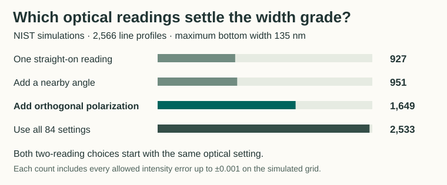

# Crest–Root applications

**What should you do when two different things give the same reading?** These seven applications let you inspect what the evidence still allows, choose an observation, enter what you measured, and keep a calculation record. Each application comes with working examples, its own input format and tests.

**[Download the complete offline workshop](https://raw.githubusercontent.com/towre676-cloud/crest-root-calculus/main/downloads/crest-root-applications.zip)**

## Open the workshop

On Windows, extract the ZIP and double-click **Start-Workshop.cmd**. The workshop uses **Python 3.11 or newer** and opens in your browser. On a Mac or Linux computer, open a terminal in the extracted folder and run `python3 workshop.py`. If the browser stays closed, open the local address printed in the terminal. Close the terminal or press Ctrl+C to stop. Python is the only installation needed for the seven default applications. [Get Python](https://www.python.org/downloads/)

Choose an application and a worked case. Change a labeled input, then choose **Run calculation**. Where the result suggests a measurement, enter it directly below the result. You can also import a different case, edit its full JSON, or save the input and result together. The original Part XXX option requires NumPy and SymPy. [Install the optional dependencies](atlas/original/README.md)

| Application | Try this decision | Evidence you can inspect |
|---|---|---|
| [Chip inspection](wafer/README.md) | Move from one ambiguous optical reading to two readings that settle the width grade. | 2,566 NIST simulation profiles, 84 settings and nine measured dies. |
| [Water leaks](water/README.md) | Choose a logger that separates two possible leak locations, then enter its reading. | Eight controlled releases in an operating Belgian network. Both fixed and adaptive pairs retained four of four sites on the held-out day with the calibrated allowance. |
| [Battery grading](battery/README.md) | Grade a retired cell when the full compatible capacity range clears the cutoff. Otherwise defer or continue testing. | 23 measured cells, each held out in turn. The simple fixed five-minute policy matched the adaptive calls and used less time. |
| [Home heat loss](retrofit/README.md) | Compare insulation and air-sealing quotes, then enter the survey that changes the decision. | Measured pre/post whole-house heat loss from two UK homes. Costs and individual upgrade effects are scenario inputs. |
| [Material structure](materials/README.md) | Find two different arrangements with identical pair distances, or index six measured diffraction peaks using a bounded cubic-cell model. | Exact finite search, an APS powder measurement and an independent NIST cell-length reference. |
| [Telescope time](orbits/README.md) | Select an observing window that would distinguish two proposed orbits, then apply a published transit timing. | 320 historical observation times and independent transit evidence for 55 Cancri e. The proposed observing windows are retrospective. |
| [Elliptic map atlas](atlas/README.md) | Search for an explicit degree-three map or a checkable exclusion on a quartic equation. | Twelve outcome-blind Sutherland rows. The original Part XXX solver excludes degree-three maps on eleven. Row 23640 stays open under the shipped budget. |

## What the results mean

In the applications, a **fibre** consists of candidates compatible with the measurements and their error bounds. Every candidate can give the same decision even when more than one survives. If the allowed decisions differ, a new reading may separate them. If no candidate explains the readings, the app reports that mismatch. These conclusions cover the input model and bounds. The field studies show how to test whether those bounds describe a physical instrument, pipe or building.

The curve atlas runs the algebraic decision machinery from the Crest–Root project. The other six applications implement domain-specific calculations using the same question about fibres. Their performance comes from their own data, geometry and measurements.

## Use the programs from the command line

Run `python wafer/app.py` for the first optical example, or `python wafer/app.py wafer/two-readings.json` for the follow-up. Each of the seven folders supports the same pattern. Method guides describe units, uncertainty, input fields and the cases where a result remains open. Raw field data retain their source attribution and licenses in the corresponding folders.

Run `python verify.py` to check all file hashes, all seven unit suites and all seven numerical receipts. To repeat the original atlas proofs, install `atlas/original/requirements.txt` and run `python verify.py --exact`. Browser developers can install Python Playwright and Chromium, then run `python verify_browser.py --chromium /path/to/chromium --exact` to exercise all worked cases, a follow-up measurement and an exported record.
