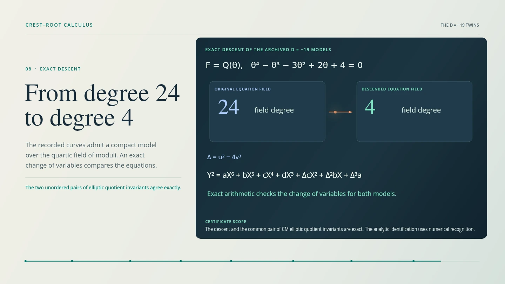

# Crest–Root visual companion

Download an exhibit and open it in a browser. Each runs offline, starts automatically and offers pause, replay and chapter controls.

| Exhibit | What it shows |
| --- | --- |
| [Program overview](Crest-Root-Visual-Monograph.html) | The inverse problem, exact map reconstruction, genus-two completeness, cubic towers, CM gluings, Hecke walks and the open residual bound. |
| [Opposite secants](Crest-Root-Opposite-Secants-Autoplay.html) | The finite geometry behind equality in every degree prime to three. The illustrated degree-nine example comes from the infinite family. |
| [The discriminant −19 twins](Crest-Root-D19-Twins-Lattice-to-Curve.html) | Follow the lattice to the branch points, descend the equations to a quartic field, then recover the lattice from the equations by certified two-torsion gluing. |

The numerical branch charts show how the models were found. The closing chapter shows how the certificate identifies each model independently, from the two elliptic cubics through their half-period labels to an integral isometry. The quotient counts agree at every degree prime to three and differ at degree three. [Equations and arithmetic verifier](../../research/elliptic-quotients/twin-curves/README.md)
