# Find the points above a chosen target

Suppose you want to find points on a quartic curve called **C⋆**. Its equation is long. The research archive found a map from C⋆ to a shorter equation, the elliptic curve $E$ given by $v^2=u^3-29u-59$. This example takes that map and **uses it backward**. You choose a point on $E$. The program finds every point on C⋆ that lands there, including any that need square roots or cubic equations to write down.

## Start with one point you can check

Pick $(u,v)=(-3,1)$. Substituting gives $(-3)^3-29(-3)-59=1$, which is $v^2$. That puts your point on $E$. The point $(-3,-1)$ works too. The picture shows both choices. Follow the circles for the first and the diamonds for the second.

<picture>
  <source media="(max-width: 640px) and (prefers-reduced-motion: reduce)" srcset="figures/narrow-still.svg" />
  <source media="(prefers-reduced-motion: reduce)" srcset="figures/wide-still.svg" />
  <source media="(max-width: 640px)" srcset="figures/narrow.svg" />
  
</picture>

The **fibre** is the set of source points for one target. Above $(-3,1)$ it contains exactly these three points. The colons separate projective coordinates. Multiplying all three entries by the same nonzero number gives another way to write the same point.

| Source point on C⋆ | Can you write it using fractions alone? |
|---|---|
| $(-3:1:0)$ | Yes |
| $(6t+1:t:1)$ with $t=(-1+\sqrt{61})/6$ | No |
| $(6t+1:t:1)$ with $t=(-1-\sqrt{61})/6$ | No |

The last two points come as a pair. Changing the sign on the square root switches one for the other. If you are collecting **rational** points, you can record $(-3:1:0)$ and move on to another target. This one target has been completely searched.

## Run the point hunt

Download or clone this repository and open a terminal in the folder containing `examples`. Use Python 3.11 or later. On Windows you can use `py` in place of `python`. Install the exact-algebra package once.

```bash
python -m pip install "sympy==1.14.0"
python examples/fibres/fibres.py
```

The default run searches above $(-3,1)$. It reports one rational point, two conjugate points, and exact checks for all three. To send the rational point back through the map, run

```bash
python examples/fibres/fibres.py forward -3 1 0
```

The output is `Target: (-3, 1)`. Try `forward 3 1 0` and the output changes to `(-3, -1)`. In the illustration, those two source points sit where a small circle or diamond meets the horizontal axis at $h=-3$ or $h=-1$, respectively.

## Change the question

Each command uses the same C⋆ map. You can choose any rational target on $E$, or send any rational point on C⋆ forward. The command `infinity` selects the point at infinity on $E$. The two hyphens in the fractional example let the command line read negative fractions as coordinates.

| Try from the repository root | What you will find |
|---|---|
| `python examples/fibres/fibres.py target -3 -1` | One rational point $(3:1:0)$ and two involving $\sqrt{3}$ |
| `python examples/fibres/fibres.py target 7 -9` | One rational point $(1:0:1)$ and two involving $\sqrt{-31}$ |
| `python examples/fibres/fibres.py target 7 9` | Three conjugate points given by one irreducible cubic, with no rational point above that target |
| `python examples/fibres/fibres.py target -- -84/25 -89/125` | A fractional target whose three sources also form one cubic group |
| `python examples/fibres/fibres.py infinity` | Three source points $(t:0:1)$, one for each root of $t^3+3t^2-31=0$ |
| `python examples/fibres/fibres.py forward 1 0 1` | The exceptional source point maps to $(7,-9)$ |

An irreducible cubic is an exact answer. Each of its three roots gives one member of the displayed group. A repeated factor would indicate that a point should be counted more than once. Every fibre has total degree three when these multiplicities are included.

**When would I use this?** Try it if you have an elliptic target point and want the corresponding points on C⋆, or if you want to study which rational targets lift to rational sources. For a different smooth quartic, the first task is to find a map specific to that equation. The [map-discovery example on the main page](../../README.md#a-real-example) describes that separate step.

## How the calculation works

Write a point of C⋆ as $(X:Y:Z)$. In the chart $Y\ne0$, set

$$
h=\frac{X-6Y-Z}{3Y},\qquad k=\frac ZY.
$$

The saved formulas become $u=hk-3$ and $v=1-hk-3h^2-kh^2-h^3$. These are the axes in the source plot. Over $(-3,1)$ we must have $hk=0$. If $k=0$, substituting into the map and the quartic gives $h=-3$. If $h=0$, the quartic reduces to $5k^2-k-3=0$. This gives the two circles on the vertical axis. In the table at the top we set $Z=1$ and use $t=1/k$ to write those same two points.

For a general finite target put $r=u+3$. Substitution eliminates $k$ and gives

$$
h^3+3h^2+rh+v+r-1=0.
$$

When $r\ne0$, every root gives the projective point $((3h^2+6h+r)/r:h/r:1)$. The parameter $h$ is recovered from every such point with $Y\ne0$. At $h=0$ the displayed formula gives $(1:0:1)$ and the target is $(7,-9)$. When $r=0$ and $v=-1$, use $(6+3h:1:0)$ for each cubic root. When $r=0$ and $v=1$, use the three-point calculation above.

To see where the map goes at $Y=0$, choose $Z=1$. The quartic there factors as $(X-1)(X^3+3X^2-31)$. Each root of the cubic gives a pole of $u$ and maps to infinity. At $(1:0:1)$ the source equation near $Y=0$ gives $X=1+6Y+30Y^2+O(Y^3)$. Substitution into $u$ and $v$ gives their finite limits $7$ and $-9$. This accounts for the exceptional point when a direct fraction would give zero divided by zero.

The script factors each fibre polynomial over the rationals. For each factor it substitutes the point formulas into the quartic and the map and checks the remainders exactly. A zero remainder verifies the identity at every root of that factor, including non-real roots. The drawing samples the real curve only.

**Archive sources.** The quartic coefficients are in `crest/scan_completeness_xxx/scan/cstar.json`. The short-form map is the first map at `(1, 0, 1)` in `crest/exact_foundry_xx/cstar_exact.json`. The independent Part XXX record `crest/scan_completeness_xxx/decision/cstar_decision.json` certifies degree three and one geometric quotient class using another target coordinate system.
