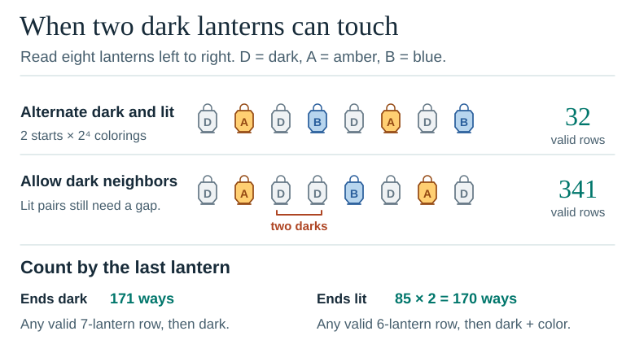

# Design a lantern puzzle

You need **200 different puzzle strips** for a school fair. Each strip holds eight lanterns in a row. A lantern can be dark, amber, or blue. How much variety will your rule leave players?

Try two rules. Under **alternating**, a dark lantern follows every lit lantern and a lit lantern follows every dark one. Under **separated**, two dark lanterns can also sit together. A dark lantern still separates every pair of lights. Read each strip from left to right. A row and its reversal count separately whenever they look different.

<picture>
  <source media="(max-width: 640px) and (prefers-reduced-motion: reduce)" srcset="figures/narrow-still.svg" />
  <source media="(prefers-reduced-motion: reduce)" srcset="figures/wide-still.svg" />
  <source media="(max-width: 640px)" srcset="figures/narrow.svg" />
  
</picture>

## Count the rows

Open a terminal in the repository’s top folder. These commands use Python 3.11 or later and its standard library. On Windows you can use `py` in place of `python`.

```bash
python examples/lanterns/lantern.py
```

```text
Alternating rows: 32
Separated rows: 341
```

**Choose the separated rule for the fair.** It gives you 309 extra designs. You can hand 200 people different rows and still have 141 left.

## Get one playable strip

```bash
python examples/lanterns/lantern.py --rule separated --index 200
```

```text
Separated rows: 341
Row 200: amber | dark | dark | amber | dark | amber | dark | blue
```

Hand each player a different number from 1 to 341 to give them different strips. The program sorts the rows using dark first, then amber, then blue. When choosing the next lantern, it counts how many rows would begin with each choice. That lets it skip a whole group of rows at once to reach the number you requested.

## Check the answer by hand

**Alternating.** Choose whether slot one is lit or dark. Either starting choice fixes the positions of four lights. Each light independently takes one of two colors, giving $2\times 2^4=32$ rows.

**Separated.** Let $T_n$ be the number of valid rows with $n$ lanterns. The empty row counts once, and a single lantern has three choices. A row ending dark can follow any valid row one lantern shorter. A row of length two or more ending lit must end in **dark, color**. The part before that pair can be any valid row two lanterns shorter.

$$
T_0=1,\qquad T_1=3,\qquad T_n=T_{n-1}+2T_{n-2}\quad(n\ge2).
$$

| Lanterns | 0 | 1 | 2 | 3 | 4 | 5 | 6 | 7 | 8 |
|---|---:|---:|---:|---:|---:|---:|---:|---:|---:|
| Separated rows | 1 | 3 | 5 | 11 | 21 | 43 | 85 | 171 | **341** |

The final step is $171+2\times85=341$. You can also test the two rules against every one of the $3^8=6{,}561$ rows. Both methods give the same counts.

## Try your own design

Suppose the strips now have 12 places and there are three light colors. Change just these two inputs.

```bash
python examples/lanterns/lantern.py --length 12 --colors 3
```

That gives **1,458 alternating rows** and **32,689 separated rows**. Color choices beyond amber and blue appear as `color-3`, `color-4`, and so on. You can assign your own names when making the strips.

The same counting problem appears in tile borders and game moves. For example, treat dark as a rest and each color as a different action. The separated rule then counts sequences in which every action gets a rest before the next action. The program counts straight sequences with labeled positions. A closed bracelet adds another neighboring pair at the clasp and needs its own counting rule.

[Back to the Crest–Root guide](../../README.md)
