# Who earned the exploration badge?

River has 90 points and Sky has 84. If the badge rewards exploring, what do you need to know before you give it away? **Find the recipe for the score.** In this game the only two ingredients are exploration points and coin points, with one point per coin.

<picture>
  <source media="(max-width: 640px) and (prefers-reduced-motion: reduce)" srcset="figures/narrow-still.svg" />
  <source media="(prefers-reduced-motion: reduce)" srcset="figures/wide-still.svg" />
  <source media="(max-width: 640px)" srcset="figures/narrow.svg" />
  
</picture>

| Player | Total | Coin points included | Exploration points | Rank change |
|---|---:|---:|---:|---|
| River | 90 | 78 | 12 | First to second |
| Sky | 84 | 64 | 20 | Second to first |

**Award the badge to Sky.** Now try changing Sky’s coin count to 72 while keeping the total at 84. The two players tie on exploration. You can change the numbers in the [offline workbook](../workbook.html#scores) or run the same calculation on your own file.

## Run the example

Extract the [repository ZIP](https://github.com/towre676-cloud/crest-root-calculus/archive/refs/heads/main.zip) and open a terminal in the folder containing `examples`. Python 3.11 or newer runs this example with its standard library.

```bash
python examples/scores/audit.py
```

## Use your own scoring rule

Make a CSV with one row per player, product, or observation. Give every row its own name, use the same units for all totals, and find out how much of the total the chosen ingredient actually contributed. The [two-player CSV](players.csv) is a working template.

For example, save this as `judging.csv` in the repository’s top folder. Each bonus token is worth three points and that bonus is included in the final score.

```csv
entry,final_score,bonus_tokens
Mira,52,10
Sol,49,8
```

```bash
python examples/scores/audit.py judging.csv --id entry --total final_score --component bonus_tokens --weight 3 --out judging-audit.csv
```

Mira keeps $52-30=22$. Sol keeps $49-24=25$. **Sol leads on the rest of the score.** Open the new CSV to see each original score, included contribution, remainder, and rank. Decimal inputs and the subtraction are handled exactly. Tied scores share a rank, so the ranks after a tie for first are 1, 1, 3. The terminal shows eight rows by default. Use `--show N` to change that limit.

## Replay the research example

The early curve study had a similar question. Its predictor, the contribution from the closest pair of zeros, already appeared inside the score to be predicted.

```bash
python examples/scores/audit.py --research --show 1
```

For the highlighted curve, the measured score rounds to **10.73**, its included part to **9.79**, and the remainder to **0.94**. Across 201 records, Pearson’s correlation between the part and the whole score is **0.9944**. Between the part and the remainder it is **−0.0316**. Pearson’s number measures how closely two columns follow a straight line. Here the near-perfect rising trend almost disappears when we remove the shared term. [See the original plots and measurements.](../../docs/figures/origins.md#checking-the-apparent-law)

## Decide whether this fits your question

This audit is useful when you know how one ingredient enters a total. For a weighted score, use its actual weight. For capped or nonlinear scoring, supply the actual awarded points as the ingredient. If the total has several other ingredients, the remainder measures **all of them together**. To find out whether coins predict future exploration, record exploration on a fresh level and compare that separate outcome with earlier coin counts.

[Back to the use cases.](../../README.md#choose-a-worked-example)
