# Catch a solver that guesses too soon

A solver says it has found **16 maps**. Did it find 16 actual maps, or 16 possibilities that might disappear on the next test? Give it two equations that look identical for three rounds and have different final answers. This benchmark lets you pick how long the disguise lasts.

<picture>
  <source media="(max-width: 640px) and (prefers-reduced-motion: reduce)" srcset="figures/narrow-still.svg" />
  <source media="(prefers-reduced-motion: reduce)" srcset="figures/wide-still.svg" />
  <source media="(max-width: 640px)" srcset="figures/narrow.svg" />
  
</picture>

## Run the experiment

From the repository folder, use Python 3.11 or later. The example uses only the standard library.

```bash
python examples/solver-tests/solver_probe.py
```

The program recomputes how many candidate **classes** still pass at each precision. A class groups maps that differ only by a change of target coordinates. Two marked points describe each class. The first column of 16 therefore starts from 32 marked points.

| Input | Modulo 13 | Modulo 169 | Modulo 2,197 | Modulo 28,561 | Proved exact count |
|---|---:|---:|---:|---:|---:|
| `fermat` | 16 | 16 | 16 | 16 | **16** |
| `delay-1` | 16 | 0 | — | — | **0** |
| `delay-2` | 16 | 16 | 0 | — | **0** |
| `delay-3` | 16 | 16 | 16 | 0 | **0** |

A dash means the program stopped after every candidate had failed. The last column asks how many geometric degree-three genus-one quotients exist on the original curve in characteristic zero. The answer **16** on Fermat uses the known exact quotient maps and the exhaustive count at 13. Finite survival by itself supplies only candidates.

## See the mistake happen

This command runs the local calculation through $13^3=2{,}197$. It then **deliberately declares every survivor a finished map**. The checker compares those claims to the exact benchmark answers.

```bash
python examples/solver-tests/solver_probe.py early --precision 3 --output premature.json
python examples/solver-tests/solver_probe.py check premature.json
```

The first three cases pass. The last prints `FAIL  delay-3: reported 16; expected 0` and the checker exits with status 1. The diagnostic tells you which solver decision to inspect: the jump from local survival to an exact count.

Can a solver get through the four tests just by checking one more digit? Yes. Try `early --precision 4` on the default inputs. It passes these four answer checks. Give the same stopping rule a fresh equation by moving the change one place to the left.

```bash
python examples/solver-tests/solver_probe.py run --delays 4
python examples/solver-tests/solver_probe.py early --delays 4 --precision 4 --output later.json
python examples/solver-tests/solver_probe.py check later.json --delays 4
```

This time the changed curve first fails at **371,293**. Any positive integer $k$ generates the corresponding `delay-k`. The default is `--delays 1 2 3`. Every selection also includes the original Fermat curve as a positive control.

## Test your own solver

If your solver accepts a quartic file and prints one JSON report, the harness can call it directly on all four equations. For a local program named `my_solver.py`, run the following from the repository folder.

```bash
python examples/solver-tests/solver_probe.py solve -- python my_solver.py "{input}"
```

The harness replaces `{input}` with a temporary file containing `{"terms":[…]}`, one fresh quartic per call. Each solver call should print a single JSON object with `scope`, `complete`, `lower`, and `upper`. Extra report fields are welcome. You can add ordinary solver options after the input path and put a per-case limit such as `--timeout 60` before the separator `--`. Solver errors, invalid reports and timeouts fail the benchmark.

For solvers that run elsewhere, pass files across instead.

1. Export the inputs with `python examples/solver-tests/solver_probe.py export --output quartics.json`.
2. Run your solver on each entry in the file’s `cases` list. Each entry contains an `id` and `terms`. A term `[i, j, k, c]` means $cX^iY^jZ^k$. If your solver accepts Part XXX’s format, its input is the JSON object containing that entry’s `terms` field. Ask for all geometric degree-three quotient classes over the algebraic closure, starting with the quartic over the rationals.
3. Collect the reports in a JSON object whose keys match the case IDs. The checker reads four fields from each report. For example, a finished positive report has `{"scope":"geometric","complete":true,"lower":16,"upper":16}`. Incomplete runs can report `"complete":false` with the actual lower and upper bounds. Save the object as `answers.json`.
4. Run `python examples/solver-tests/solver_probe.py check answers.json`. Use the same `--delays` as for the export. A correct verdict has the expected count, matching integer bounds, geometric scope and `complete` set to `true`. Missing or unexpected cases, incomplete runs and wrong bounds fail. Status 0 means all reported answers matched, 1 means a benchmark mismatch, and 2 means the inputs or invocation could not be read.

The checker tests the **answers your solver reports**. Its input format takes no proof transcript. A solver that guesses the right final numbers can pass a fixed set, which is why the adjustable delay and independent local recomputation are useful.

## Why the disguise works

Start with $F=X^4+Y^4+Z^4$ and $D=-5X^2Z^2-4Y^2Z^2$. In the changed curve $F+13^kD=0$, both added coefficients are divisible by $13^k$. Their first $k$ base-13 digits are zero. At the next place, $-5$ gives digit 8 and $-4$ gives digit 9. In the picture, $k=3$, so the first different digits appear modulo $13^4=28{,}561$.

A changed coefficient alone need not destroy a map. **The lift test checks that it does for this particular direction.** The 32 regular marked solutions at 13 are grouped in pairs in [seeds.json](seeds.json). At each next power the integer quartic is substituted into the map equations. The resulting two-parameter linear system in the next digits either has one lift for a mark or none. The program checks that both marks of every class agree. It follows the surviving marks and stops when all have failed or the requested precision is reached.

The initial classification, smoothness and completeness argument come from the integrated research archive, Part XXX §§141–144 and the Fermat classification in §128. In particular, §142 proves that delaying this direction by $k$ digits delays the first obstruction to $13^{k+1}$. The shipped [local lifting engine](compressed_lift.py) is the release’s `scan/compressed_lift.py`. The starting states are the two frame coordinates, pencil slope and intercept extracted from `scan/nonlift_13.json` for every mark. The default depth sequences match `scan/delayed_lift_receipt.json`.

[Return to the main guide](../../README.md)
