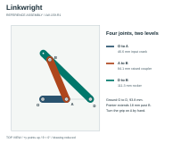

# Linkwright · Build a working four-bar

**Turn one handle. A pointed arm swings about 60° and takes about 1.8 times as much crank rotation going out as coming back.** LW-159-R1 is a hand-operated tabletop build with one plywood base, three moving pieces, four smooth shafts and a finger grip. The pointer is part of the rocker. The released hardware and clearances cover the bare pointer on a horizontal board.

**[Download the complete kit for Windows, Mac or Linux](https://raw.githubusercontent.com/towre676-cloud/crest-root-calculus/main/downloads/linkwright-implementation-kit.zip)** · **[Read the fabrication guide on GitHub](kit/README.md)** · **[Read the engineering results](verification/README.md)**

## From screen to workbench

1. **Open the workshop.** On Windows, right-click the ZIP, choose **Extract All**, then double-click `index.html` in the extracted folder. The motion builder, 3D view and bench record work offline. Online links to source references and the ZIP require an internet connection.
2. **Inspect the assembly.** Open `assembly-view.html`. Turn the crank, drag to orbit the model or spread its 39 solids. Download the STEP to inspect it in a CAD program. The drawing packet shows the cutting dimensions, hardware quantities, joint stack order and how to set endplay. [3D CAD model](cad/reference-assembly.step) · [Nominal CAD verification](cad/receipt.json)
3. **Fabricate the reference.** Use pages 3 and 4 of the packet for the base and moving parts. Print at actual size and measure both scale axes. Match the finished bores, centre spacings and stock thickness to the drawing. For CAD/CAM use the supplied millimetre DXFs with your shop’s tool compensation. [A4 drawings](kit/build-a4.pdf) · [US Letter drawings](kit/build-letter.pdf) · [Base DXF](kit/cut-base.dxf) · [Moving links DXF](kit/cut-links.dxf)
4. **Measure the finished unit.** Mark the collar locations, verify free play and clearances, then turn the bare mechanism ten times each way. Measure three sets of crank and rocker reversals using the full-size angle gauge. Open `commissioning.html` to enter the readings and save a build-specific record. A reading too close to a limit for its stated measurement error stays open for remeasurement. [Angle gauge](inspection/angle-gauge.pdf) · [Inspection procedure](kit/README.md#3-commission-the-actual-build)

## What the design guarantees

| Question | Result for this revision |
| --- | --- |
| What should I measure? | For the nominal rigid build, **59.985° of swing** and **1.8008:1** long/short stroke ratio. The increasing stroke takes 231.466° of crank travel. Its time ratio assumes constant crank speed. |
| What if my cut is slightly off? | With each of the four centre spacings within **±0.25 mm**, concentric rigid joints give **58.895–61.092°** and **1.767–1.837** across the full dimensional box. |
| Can the shaft triangle flatten or the lower bars strike? | Allowing the specified pin play in the rigid parallel-shaft model, every angle retains at least **18.27 mm** folded triangle margin, **22.006°** acute shaft-axis transmission angle, and **4.828 mm** between the lower crank and rocker outlines. |
| What still needs a real build? | The modeled moving shaft tail clears the deck by at least **0.850 mm** under the parallel-shaft assumptions. Check actual tilt, fit, flex, friction, retention and unintended gaps. The physical acceptance bands are **57–63°**, **1.65–1.95**, and at least **0.50 mm** of unintended clearance. No physical first-article pass is recorded in this release. |

**An important scale correction.** The original cardboard example used ideal lengths to select a size and rounded them on the cutting sheet. The revised builder runs the tests on the dimensions it actually exports. At **159%**, the rounded geometry can toggle with four adverse **5 mm** spacing errors. **160%** is the first passing whole-percent scale for that cardboard exercise. The fixed **159% plywood kit** has its own ±0.25 mm spacing specification. [Tolerance calculation and exact adverse dimensions](verification/README.md)

## Design another motion

The workshop also synthesizes a four-bar from a requested swing and timing ratio or fits a tracing point to a closed path you draw. Adjust the stock, drive direction, scale and spacing tolerance, then save the parts SVG and design JSON together. The software reports realized motion after rounding, both print scales, full-turn closure and the measured path-fit error. Custom hardware, loads, attachments and their clearance need a design check for that specific mechanism. [Custom design guide](custom-design.md)

The configuration curve also answers a different question about repeated reflections of the same linkage. Both the nominal wing and the rounded printable wing have infinite double-flip order. [Configuration curves and proof](https://github.com/towre676-cloud/crest-root-calculus/tree/main/research/configuration-and-certificates/mechanisms)

## Reproduce the digital checks

From the extracted folder run `python verify.py` with Python 3.11+ and Node.js. The default command checks file hashes, reruns the engineering enclosure and its counterexamples, and tests the builder and physical-record logic. The browser pages and production files need neither Python nor Node to use.

| Optional checks | Command |
| --- | --- |
| Reopen finished drawing files (PyMuPDF and ezdxf) | `python verify.py --drawings` |
| Rebuild and reopen the nominal 39-solid assembly in a temporary directory (CadQuery 2.7) | `python verify.py --cad` |
| Exercise both design modes, offline downloads, 3D assembly and physical-record round trip (Python Playwright and Chromium) | `python verify.py --browser /path/to/chromium` |

The public reference includes physical acceptance criteria and a blank inspection form. The numerical receipts describe design calculations and software tests. A signed-off measured unit is the next step before duplicating the build or assigning any motor, external load, duty cycle or service-life rating.
