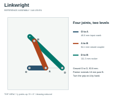

# Build the Linkwright reference wing

**Turn the grip at A. The short crank goes around once while the long pointer swings out and back.** This kit builds the 159% Linkwright wing as a horizontal, hand-operated plywood demonstrator. A single board carries two fixed shafts. Three flat parts, four smooth shafts, and ten removable collars make the assembly serviceable. The raised coupler can pass over the crank pivot.

**Print the six-page workshop packet for your paper size.** Pages 3 and 4 are full-size templates. Print the separate angle gauge at actual size too. Measure the 50 mm references in **both** directions on **each** of these three physical sheets. Each measured interval, including the reading uncertainty, must lie within 49.75–50.25 mm. Reprint if they fall outside this range. Even a correctly scaled sheet still requires checking the finished parts. [US Letter packet](build-letter.pdf) · [A4 packet](build-a4.pdf) · [Full-size angle gauge](../inspection/angle-gauge.pdf) · [3D reference assembly](../cad/reference-assembly.step)

| Shop operation | File | How to use it |
| --- | --- | --- |
| Print, mark and drill | Build packet above | Tape to the blank without stretching it. Mark every pin centre before removing the paper. |
| CNC or send to a fabricator | [Base DXF](cut-base.dxf) · [Link DXF](cut-links.dxf) | Files use millimetres. PROFILE contains closed outer contours. BORE contains finished-size circles. The shop supplies tool compensation. |
| Open the same contours in a vector editor | [Base SVG](cut-base.svg) · [Link SVG](cut-links.svg) | Physical millimetre dimensions and a 1 mm drawing margin. Set cut paths to the **centre** of the stroke. |
| Inspect or regenerate the design | [Dimensions and acceptance limits](design.json) · [Drawing generator](generate.py) | The specified geometry is the authority for this revision, LW-159-R1. |

## 1. Measure the parts

All dimensions are in millimetres. Set the base on a flat bench with its top face upward. The left-to-right line from crank axis **O** to rocker axis **D** defines angle zero. Counterclockwise angles are positive when viewed from above. Shaft A joins crank and coupler. Shaft B joins coupler and rocker. The output pointer is an extension cut **as one piece** with the rocker.

| Qty | Stock or hardware | Finished specification |
| ---: | --- | --- |
| 1 | Base board, flat birch plywood | 174 × 207 × 6.0 ±0.2. Each outside edge within ±0.5 of its template. Flatness ≤0.30. |
| 3 | Moving links, flat birch plywood | 3.0 ±0.1 thick, nominal width 14.0 ±0.4. The profile is the radius-7 capsule on the indicated line. Keep the finished edge within 0.20 of its nominal profile and flatness within 0.20. |
| 4 | Shafts, ground smooth steel rod | Diameter 2.98–3.00. One straight piece at least 150 long yields three 32 blanks and one 43 blank, allowing for cuts. Final length is set by each actual stack. |
| 10 | Three-millimetre bore set-screw collars | Nominal outside diameter 7, width 5.0 ±0.1. Minimum OD 6.5. Maximum swept diameter including the screw is 10.2. A purchasing example is Mädler 623003006, 3 × 7 × 5 with M2 × 3 screw. [Manufacturer dimensions](https://maedlernorthamerica.com/partshop/shaft-collar-din-705-a-bore-3mm-set-screw-din-en-iso-4027-old-din-914-pn-623003006/) |
| 12 | Flat thrust washers | Bore 3.10–3.30, OD 6.5–8.0 (nominal 7), thickness 0.50 ±0.05. Use flat, burr-free faces. |
| 2 + 2 | Rigid metal or engineering-plastic spacers | Bore 3.05–3.30, OD 5–8 (nominal 6). Two at 3.0 ±0.1 and two at 10.0 ±0.1. A measured tube with square, finished ends works. |
| 1 | Cylindrical finger grip | Wood or bondable polymer, OD 10 ±0.3, length 15 ±0.5. Drill axially to fit the shaft with a 3.05–3.20 bore. Set installed engagement to 9.5–10.5. Keep at least 4 of closed material at its top. |
| 4 | Adhesive feet | 15-square footprint. Height measured **installed** under the assembled unit is 12 ±0.5. Foot centres sit 12 ±1 from each adjoining base edge. |
| as used | Adhesive, layout and inspection supplies | Use a two-part adhesive specified by its maker for the chosen grip and steel. Use an adhesive suited to the feet and base, a matching key for the collar screws and a fine witness-mark pen. |

**Bare pointer rating.** This configuration covers intrinsic moving parts and slow hand input. A motor, an attached wing or an external force changes the load, dynamic clearances and retention requirements. Material strength, fatigue life and drive torque are unqualified for such service.

### Pin fits and stock dimensions

| Item | Datum and nominal dimension | Finished acceptance |
| --- | --- | --- |
| Ground O and D | From the lower-left base corner O=(62.00, 62.00), D=(155.80, 62.00) | Each coordinate within ±0.25 **and** the actual O–D spacing within 93.80 ±0.25. Both bores Ø3.00–3.05. |
| Crank O–A | 46.60 | ±0.25, both bores Ø3.10–3.20. |
| Coupler A–B | 84.10 | ±0.25, both bores Ø3.10–3.20. |
| Rocker D–B | 111.30 | ±0.25, both bores Ø3.10–3.20. |
| Pointer witness T on line D–B | T sits 18.0 beyond B, at the **centre** of the rounded end | ±0.3. Mark T in ink. The material extends another 7 beyond T. |

The manufacturing outlines use bore diameters 3.025 and 3.15, the centres of the two fit ranges. For wood, cut or drill undersize if needed and finish on a backed scrap coupon before the actual part. Use a drill press or a square drill guide. Align the face grain to the long dimension of each strip. Sand lightly, remove splinters and leave the contact faces flat. Recheck coated or sealed parts after curing.

With two snug gauge pins seated in the holes, measure outside-to-outside and subtract half the sum of their measured diameters. Repeat from the opposite sides to spot rocking or burrs. A digital caliper alone generally cannot distinguish a 3.00 bore from a 3.05 bore reliably. Use known gauge pins or measured gauge stock for these limits. Check the spacing even if all cut lengths look right.

## 2. Stack the joints

Place the four feet, then pass vertical shafts through O and D. Immobilize each ground shaft with **one collar below the base and one immediately above it**. Keep each shaft within a 1° cone of the board normal. A square in two perpendicular directions with no more than 0.30 lateral deviation over 25 in either view is a sufficient shop check for that cone. Use a straight temporary extension for checking short pins. Inspect shaft lean and strip flatness again after setting the collars.

| Joint | Stack from bottom up | Reference heights above the base top |
| --- | --- | --- |
| O, D | Bottom collar → base → clamp collar → 3 spacer → thrust washer → lower moving link → washer → 0.15–0.35 free play → top collar | Base top 0. Lower link rests at 8.5–11.5. Nominal ground top collar 12.25–17.25. |
| A, B | Bottom collar → washer → lower moving link → washer → 10 spacer → washer → upper coupler → washer → 0.15–0.35 free play → top collar | Upper link rests at 22.5–25.5. Nominal moving top collar 26.25–31.25. |
| A only | Above the top collar leave a 0.5–1.0 gap, then fit the finger grip over 9.5–10.5 of the extended shaft | Nominal grip bottom 32 and top 47. |

Use a 0.25 feeler blade between the last washer and the top retaining collar while positioning that collar. Tighten its set screw, withdraw the blade, and verify **total axial float of 0.15–0.35** at the retained pack. The pressure that clamps the ground pins to the board is separate from the free play that lets the links rotate. Unused shaft ends project 0–0.6 beyond their collars. Nominal cut lengths of 29.0 at O/D, 28.9 at B and 39.3 at A are starting estimates. Measure the particular hardware, trim, chamfer the rod ends and remove burrs. Keep set-screw dents outside the running surfaces of the joint.

At crank zero, A is at (46.6, 0). Place B near (13.90, 77.48) relative to O. The line O–D is below B in this pose. With that orientation fit the coupler **above** the lower two links. Turn through a complete cycle before bonding the grip. Dry-fit the grip, confirm the collar gap and shaft engagement, then prepare the bonding surfaces and allow the adhesive to reach the maker’s full cure for service before inspection. Keep adhesive off the thrust washers and bearing holes. Check all corners sit on their feet.

## 3. Commission the actual build

Use the [bench record](../commissioning.html). Enter this kit’s revision, a unique build identifier, the gauge or instrument used, and the date. Use the [angle gauge](../inspection/angle-gauge.pdf) with actual-size printing. An overhead image must be square to the base, scaled in both directions, with the axes identified. On the paper gauge, sight from O through A to the blue graduations and D through B to the orange graduations. Near the extended reversal the coupler covers the forward crank tick. Sight from A through O, read the opposite tick, then add 180° and wrap to [0°, 360°). Use the same back-sight method for the intentionally blank sector where the scales would cross. For image measurements, use lines through the centres of O–A and D–B to avoid parallax from the raised grip.

1. **Record dimensions before motion.** Enter the actual four pin-centre spacings. In the build notes record the measured bores, shaft diameter, stack float, board/strip flatness, shaft alignment and grip engagement. Photograph all four stacks and mark a witness line across each of the ten collars and its shaft.
2. **Check clearance by hand.** Place the board on a level nonslip surface or restrain its edges clear of the motion. Turn the finger grip slowly through ten complete turns clockwise and ten counterclockwise. Stop on any contact, loose hardware or hard point. At the closest encounters stop motion and find a blade that slips freely at every accessible unintended close approach. Record the smallest such passing thickness and its positive measurement uncertainty. Their difference must reach **0.50 mm**. A passing 0.55 ±0.02 blade establishes at least 0.53 mm. A passing 0.50 ±0.02 blade establishes only 0.48 mm and requires a better check. Inspect especially the crank/rocker crossing region, the coupler over O, the moving lower collars over the deck and the ground collars over the bench. Intended contact at thrust and bearing surfaces permits smooth movement. Check the grip and top keepers remain secure.
3. **Measure three counterclockwise sweeps.** Approach both rocker reversals while continuing the input in the same direction. Record the input crank angle at each reversal and the two extreme rocker angles. The rocker swing must be **57–63°** on each sweep. From the smaller rocker angle to the larger, measure the **counterclockwise** input travel Δ by subtracting the two crank readings and wrapping into [0°, 360°). The increasing/decreasing stroke ratio is Δ/(360° − Δ). This directional test can detect a reversed assembly or a mislabeled stroke. Each ratio must be **1.65–1.95**, including angular reading uncertainty. An observer who measures an extremum by sight should bracket it with readings on either side and repeat if its position is ambiguous. Hand timing alone cannot measure this geometric ratio.
4. **Inspect again.** Recheck axial float, collar marks, grip bond and feet. A passing sheet belongs to the measured unit. If anything changes, document the repair and repeat the full test.

A check on an as-built unit can uncover friction, shaft lean, loose fasteners or warp even when the geometry is correct. The independent [engineering verification](../verification/README.md) explains the model assumptions and its clearance and motion bounds. The physical release evidence begins with the commissioning record from a fabricated unit.

For the nominal rigid build, input angles **56.61° and 288.08°** mark the rocker reversals. The output extremes are **101.33° and 161.32°** in the ground-axis frame. The crank travels about **231.47°** on one stroke and **128.53°** on the other. These predictions help locate the reversals. Enter observed readings from the assembled mechanism.

## 4. Locate a fault

| Observation | Check first |
| --- | --- |
| Hard stop or linkage folds unexpectedly | Confirm the four spacings and the positive-B assembly branch at crank zero. Check that O/D clamp collars are below the lower bars and that both 10 mm spacers are between the two levels. |
| Stiff everywhere | Inspect axial float and burrs. Check the holes with gauge pins, loosen and refit the top keeper, and confirm the board and links sit square. |
| A scrape once per revolution | Stop at the offending angle. Examine coupler versus O keeper, crank versus rocker, moving shaft tail versus deck, protruding screws and bent strips. Refit before continuing. |
| Unsteady base or slipping grip | Check installed foot heights and all ground shaft tails. Verify the grip bond, engagement and witness marks. Repeat acceptance after repair. |
| Swing looks correct but ratio misses | Verify the direction convention, circular wrap and both crank-reversal readings. Use input angles for the ratio and output angles for the swing. Record another complete sweep only after correcting the setup. |

To regenerate source artwork with Python 3.11 or later, install `reportlab` and `ezdxf` and run `python generate.py` in this folder. The optional artwork checks read the finished PDFs and DXFs directly. Install `pymupdf` and `ezdxf`, then run `python test_drawings.py`. They check both calibrated axes, all eight bore centres, physical units, outer contours and the two semicircular ends on each link. Finished SVG, DXF and PDF files are included, so fabrication and inspection require no software installation.
