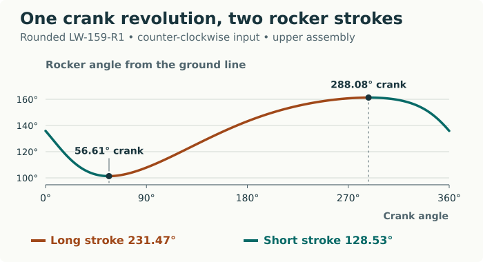

# Engineering verification · LW-159-R1

**The cut reference swings 59.985° and takes 1.801 times as much crank rotation on the longer stroke.** Turn the crank counter-clockwise with the board’s $O$–$D$ line pointing right. The rocker reverses when the crank reads 56.612° and 288.078°. The longer stroke covers 231.466° of crank rotation and the shorter covers 128.534°. At constant crank speed, those angular spans give the time ratio. A person turning by hand can vary the timing.



## Set the correct assembly branch

Measure from crank pivot $O=(0,0)$, with fixed rocker pivot $D=(93.8,0)$ mm. $A$ is the crank handle axis, $B$ the moving rocker joint and $T$ the centre of the rounded pointer tip. Lay the assembly so that $B$ lies to the **left** when looking from $A$ toward $D$. At zero input, both $B$ and the pointer should be above the ground line. These coordinates are nominal marks for orientation and troubleshooting.

| Crank | $A$ in mm | $B$ in mm | $T$ in mm |
| ---: | ---: | ---: | ---: |
| 0° | (46.60, 0.00) | (13.90, 77.48) | (0.98, 90.01) |
| 90° | (0.00, 46.60) | (59.62, 105.92) | (54.09, 123.05) |
| 180° | (−46.60, 0.00) | (4.67, 66.66) | (−9.74, 77.44) |
| 270° | (0.00, −46.60) | (−11.26, 36.74) | (−28.25, 42.69) |

## Which variation does the calculation cover?

The [fabrication specification](../kit/design.json) is the input. The four pin spacings $(g,a,b,c)=(93.8,46.6,84.1,111.3)$ mm each have a ±0.25 mm acceptance band. With concentric, rigid bearings and *fixed* dimensions anywhere in those bands, the rocker swing lies in **58.895–61.092°** and the long/short ratio in **1.767–1.837**. The bounds enclose all such builds. Changing bearing contact within a loose joint during a turn can shift the observed reversal angles. Use the physical dial and repeated measurements for that effect.

To compute the extrema, let $r=|OB|$. At a rocker reversal the crank and coupler are collinear, giving $r=b+a$ or $r=b-a$ on this branch. The output angle is $\arccos((r^2-g^2-c^2)/(2gc))$, and the angle of $OB$ is $\arccos((r^2+g^2-c^2)/(2gr))$. Add 180° to the latter on the folded stroke, because the crank then points opposite to $OB$. The checker subdivides the spacing box into $4^4$ closed boxes and encloses both reversals in each. The enclosure of each cosine uses outward-rounded integer arithmetic. Degree and ratio displays use the monotone inverse cosine from the system math library with a display guard. [Four-bar position analysis](https://mechanicaldesign101.com/wp-content/uploads/2020/10/Howell-21stCenturyKinematics-Aug2012.pdf)

For swept clearance, allow each shaft to sit anywhere its inspected hole permits. The largest radial offset is **0.035 mm** in a base hole and **0.11 mm** in a moving hole. Differences between the two end offsets can change a shaft-axis spacing by twice that radius. Thus the worst-case intervals for $g,a,b,c$ are $[93.48,94.12]$, $[46.13,47.07]$, $[83.63,84.57]$ and $[110.83,111.77]$ mm. These are conservative independent intervals for axes in parallel planes.

**The minimum folded clearance is 18.27 mm and the minimum reach clearance is 53.27 mm.** These length margins keep the assembly triangle open for the entire input turn. They follow by taking the extrema of $|g-a|-|b-c|$ and $b+c-g-a$. By the cosine law, the acute coupler–rocker angle between the shaft centrelines stays above **22.006°**. The complete fraction for the cosine bound appears in the [receipt](receipt.json). The drilled lines of the two bars can rotate slightly relative to those centrelines. Allowing those two angular offsets gives **21.741°** for the drilled link centrelines. The minimum radial ligament around a moving end bore is **5.00 mm**; the minimum radial washer overlap at a moving link, including eccentric bores, is **1.38 mm**. Neither number is a rated bearing load.

**The old ±5 mm example is a change point for these rounded dimensions.** Even before adding pin play, the smallest folded margin for the cutting drawing is $20.0-4(5)=0$ mm. A witness is $(88.8,51.6,79.1,116.3)$ mm at zero crank angle. Reliable operation requires the tolerances specified for this kit.

## Full-turn interference check

The checker models each strip by a capsule, enlarges it for the width tolerance, profile error and shaft-to-bore offset, and carries the rocker past $B$ to its integral tip. Each joint cylinder encloses its collars, projecting screws and washers. The cylinder at $A$ also encloses the grip and its loose bore. Designed bearing and washer contact at a link’s own joint is part of the fit. The check covers all six joint-to-joint pairs, all six link-to-nonincident-joint pairs, and the two lower links. The upper coupler also has to clear the lower links vertically.

| Separation in the parallel-shaft model | Proven lower bound |
| --- | ---: |
| Lower crank strip to the rocker/pointer strip | 4.828 mm |
| Rocker/pointer to handle stack $A$ | 7.078 mm |
| Upper coupler to fixed crank hardware $O$ | 1.950 mm |
| Upper coupler to the lower links in height | 8.550 mm |
| Bottom end of either moving shaft above base | 0.850 mm |
| Underside of ground retention above a flat table | 5.500 mm |
| Smallest horizontal margin inside the base outline | 6.101 mm |
| Fixed bottom collars to any foot in plan | 32.495 mm |

The [receipt](receipt.json) lists every pair and all four board margins. These lower bounds include the stated stack extremes, endplay, board and strip flatness allowances in the height stack, foot positioning and the permitted fixed-pivot coordinate errors. For the board outline, the checker encloses the translation and rotation from the actual $O$–$D$ datum to the board edges. A square foot may rotate within its specified corner position.

**How the sweep covers unsampled positions.** For the first quadrant use the half-angle parameter $t=\tan(\theta/2)$ on $[0,1]$, with $\cos\theta=(1-t^2)/(1+t^2)$ and $\sin\theta=2t/(1+t^2)$. Both are monotone there. Divide this interval into 128 pieces and rotate the result through four quadrants. Each of the 512 closed arcs encloses a continuum of angles. In each arc the circle-intersection formulas enclose every joint position throughout the entire tolerance box. A separating axis projects the two swept segments to disjoint intervals. Dividing their projected gap by an upper bound for the axis length and subtracting the two capsule radii gives a valid lower bound. A coarse enclosure can underestimate clearance. It cannot certify an overlapping pair as clear. All linear distances in this sweep use integer interval endpoints rounded outward on a $10^{-8}$ mm grid.

The stack proof assumes the shaft axes are parallel to the board normal and the stock follows the modeled planes. The shop’s 1° perpendicularity check is an inspection limit. A leaning shaft, warped moving strip, off-centre grip, loosened collar or side force can consume that **0.850 mm** modeled deck clearance. Gauge the gap over slow complete turns with the assembled hardware. The acceptance procedure calls for at least **0.5 mm** unintended clearance, repeated reversal measurements and hand cycling in both directions. Torque, efficiency, service life and loaded operation require physical measurements. [Fabrication kit](../kit/) · [Return to Linkwright](../README.md)

## Reproduce

With Python 3.11 or later, from this directory:

```sh
python check.py --check
python -m unittest discover -v
```

The first command regenerates the four-bar geometry from the kit’s JSON and compares it to the stored receipt. The six regression groups exercise interval arithmetic, both reversal poses, clearance counterexamples, and an independent polar-coordinate solver at **2,880** combinations of crank angle and effective shaft-spacing corners. Counterexamples include a short spacer, overly wide links, an undersized board, short feet, an undersized washer, a seized bore and the wrong assembly branch.
