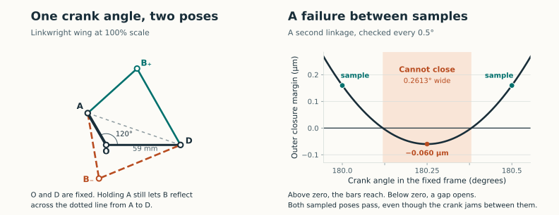

# Part I · Configuration curves of planar mechanisms

**An exact consequence for the wing.** Starting at any pose, reflect the moving triangle while keeping the crank fixed. Next reflect while keeping the rocker fixed. Repeat this *pair* of operations. For both rounded versions of the Linkwright wing studied here, the starting pose never returns after a positive number of double flips. This is a statement about a geometric operation on the configuration curve. An actual crank can still complete a turn. Two short finite-field computations prove the non-return.



## Closure, branch points and the quartic

Let the fixed pivots be $(0,0),(g,0)$ and the crank, coupler and rocker lengths be $a,b,c>0$, respectively. Angles $\theta,\varphi$ run from the positive horizontal to the crank and rocker. Write $d^2=g^2+a^2-2ga\cos\theta$. For the free crank and rocker pins to be exactly $b$ apart, their angles must satisfy

$$
2c(g-a\cos\theta)\cos\varphi-2ac\sin\theta\sin\varphi=b^2-c^2-d^2 .
$$

**Closure theorem.** The discriminant for the rocker at a given crank angle is

$$
\Delta=4c^2d^2-(b^2-c^2-d^2)^2
       =((b+c)^2-d^2)(d^2-(b-c)^2).
$$

This is $16$ times the squared triangle area. For $d>0$, positive, zero and negative values give two, one and zero real rocker directions. The two possibilities have opposite oriented areas. At the exceptional coincident centers $d=0$, every rocker direction works if $b=c$ and none works otherwise.

Set $t=\tan(\theta/2)$. The parametrization of the input circle is projective and includes $t=\infty$. For $x=(g-a)^2$, $z=(g+a)^2$, $U=(b+c)^2$, $L=(b-c)^2$, define

$$
\alpha_0=U-x,\quad \alpha_1=U-z,\quad
\beta_0=x-L,\quad \beta_1=z-L.
$$

Since $d^2=(x+zt^2)/(1+t^2)$, the polynomial obtained by clearing the square denominator in $\Delta$ is

$$
H(t)=(\alpha_0+\alpha_1t^2)(\beta_0+\beta_1t^2)
    =At^4+Bt^2+C.
$$

Here $A=\alpha_1\beta_1$, $B=\alpha_0\beta_1+\alpha_1\beta_0$ and $C=\alpha_0\beta_0$. The equation in the two projective half-angle coordinates $(t,u)$ has bidegree $(2,2)$. Its discriminant gives the birational double-cover model $Y^2=H(t)$, whose smooth projective completion we denote by $C_L$. Thus the bidegree describes the original **two-angle equation**. The four branch points of the double cover are the roots of $H$, over the algebraic closure. Real branch points are collapsed triangles for this crank projection.

**Arithmetic theorem.** Let $\Pi=AC$ and $\kappa=16abcg$. Subtracting the cross products gives $\alpha_0\beta_1-\alpha_1\beta_0=(z-x)(U-L)=\kappa$. Consequently $B^2-4AC=\kappa^2$. The binary discriminant and the smooth curve's invariant are

$$
\operatorname{disc}H=16AC(B^2-4AC)^2=2^{20}(abcg)^4\Pi,\qquad
j=\frac{16(16\Pi+\kappa^2)^3}{\Pi\kappa^4}.
$$

Indeed the quartic invariant $I=B^2+12AC$ equals $16\Pi+\kappa^2$, and $j=256I^3/\operatorname{disc}H$. Smoothness holds exactly when $\Pi\kappa\ne0$. Four simple branch points give genus one by Riemann–Hurwitz. For rational lengths the Jacobian is an elliptic curve over $\mathbb Q$. Identifying $C_L$ itself with its Jacobian over $\mathbb Q$ requires a rational point.

**A physical example with no rational pose.** The lengths $(2,1,2,2)$ allow a strict full revolution over the reals. The homogeneous quartic is $(15d_0^2+7n^2)(d_0^2+9n^2)$ for $t=n/d_0$. At primitive integral $(n,d_0)$ its residues modulo 16 are exactly $7,12,15$. The square residues are $0,1,4,9$. A rational square that is an integer is an integer square. This proves that the compact genus-one curve has no rational point, including at infinity.

## Strict Grashof, turning and transmission

**Real classification.** Suppose the sorted lengths $s_1\le s_2\le s_3\le s_4$ obey $2s_4<S=\sum s_i$ and the curve is smooth. Strict Grashof, $s_1+s_4<s_2+s_3$, is equivalent to $\Pi>0$ and to the real locus having two connected components. One proof factors $\Pi$ as

$$
-S\prod_i(S-2s_i)
(s_1+s_2-s_3-s_4)(s_1+s_3-s_2-s_4)(s_1+s_4-s_2-s_3).
$$

The first two pair-sum differences are negative away from the wall. The signs yield the criterion. The binary quartic has zero or four real branch points at positive discriminant and two at negative discriminant. In the four-root case, the two positive arcs give two components. With zero real roots and a real pose, the two signed square roots extend around the projective input circle in the degree-two real line bundle, which is trivial. Two simple real branch points give one component. Grashof equality is a singular change-point. If the longest length exceeds the sum of the others, there is no real pose; a smooth complex curve in this case is still geometrically connected.

For the specific grounded input crank, strict real closure through a whole turn requires exactly

$$
b+c>g+a,\qquad |g-a|>|b-c|.
$$

These are $\alpha_1>0$ and $\beta_0>0$. Necessity and sufficiency follow because $d$ traverses the **entire** interval $[|g-a|,g+a]$. This particular crank need not rotate in every Grashof ground-link assignment. Equality admits a toggle and falls outside the strict claim.

**Transmission theorem.** To keep the acute transmission angle strictly above $\mu_*$, put $k=\cos\mu_*\in(0,1]$, replace $U,L$ with $b^2+c^2\pm2kbc$ and use the same two endpoint tests. They follow from the law of cosines. The cross product becomes $k\kappa$. At a grazing threshold replace the strict inequalities with non-strict ones. These tests use the monotonic endpoint distance and two linear factors in $t^2$. A general quadratic on the positive half-line cannot be tested from its end signs alone.

For independent cut errors $|\delta l_i|\le e<\min l_i$, the worst folded margin is
$$
\max(0,|g-a|-2e)^2-
\max_{b'=b\pm e,\ c'=c\pm e}(b'^2+c'^2-2kb'c').
$$
The squared pivot distance reaches its minimum when the two intervals come closest. The quadratic subtracted here is convex on the rectangle, so a maximum occurs at a corner. The worst extended margin is
$$
(b-e)^2+(c-e)^2+2k(b-e)(c-e)-(g+a+2e)^2 .
$$
Each bound is attained. Their minimum tests the **whole error box**, and bisection with rational endpoints brackets the first loss of clearance in the positive-length domain. For $k=19/20$ the uniform-error thresholds of the two rounded wings are approximately **1.18346034 mm** and **1.87302571 mm**. The receipt supplies a passing lower radius and a failing or limiting upper radius. These thresholds impose a transmission angle of about $18.19^\circ$, a stronger requirement than simple closure.

At $k=0$ the quartic is minus a square. A positive crank and ground make $d^2$ vary across the revolution, so no such four-bar maintains a right transmission angle throughout. Usually $j\to\infty$ as $k\to0$. If either $(g-a)^2$ or $(g+a)^2$ equals $b^2+c^2$, $j\to1728$ instead. To see this, put $h=2kbc$, $q=b^2+c^2-x$ and $r=b^2+c^2-z$. Then $\Pi_k=(h^2-q^2)(h^2-r^2)$ and $(k\kappa)^2=4h^2(q-r)^2$. Substitution gives both limits. The exceptional case occurs for $(g,a,b,c)=(3,2,3,4)$.

**An obstruction between two frames.** If $\alpha_0>0$, $\alpha_1<0$ and the second factor stays positive, the failing arc about the ground-relative angle $\pi$ has exact width
$$
4\arctan\sqrt{|\alpha_1|/\alpha_0}.
$$
The leading term is $4\sqrt{|\alpha_1|/\alpha_0}$ in radians. Grid spacing below the width guarantees detection for every phase. A coarser grid can hit or miss it depending on alignment. The packaged regression has lengths $(100,30,75,54.99994)$ mm and a $0.25^\circ$ ground rotation. Its failing arc is $(180.1193455^\circ,180.3806545^\circ)$, so all 720 evenly spaced poses pass. The outer margin is exactly $-0.00006$ mm.

## Arithmetic of alternating reflections

Each projection has a degree-two fibre class $F_i$ defined over $\mathbb Q$. At $P\in C_L$ its deck involution sends the degree-one divisor class $[P]$ to $F_i-[P]$. The double flip in crank-then-rocker order therefore acts by translation by $T=[F_2-F_1]$ in $J_L(\mathbb Q)$. Translation by a nonzero point has no fixed points on the genus-one torsor. A double-flip return after $n$ steps is equivalent to $nT=0$, independently of the starting pose. This is the geometric folding porism applied to oriented configurations. Mazur's theorem permits period $1,2,\ldots,10,12$ for rational-length four-bars with nonsingular curve. [Izmestiev, *Deformation of quadrilaterals and addition on elliptic curves*](https://arxiv.org/abs/1501.07157) · [Mazur, *Modular curves and the Eisenstein ideal*](https://doi.org/10.1007/BF02684339)

**Theorem for the rounded Linkwright wing.** In each row below, the rational torsion subgroup is exactly $\mathbb Z/2$ and $T$ has **infinite order**.

| Rounded lengths $(g,a,b,c)$ in 0.1 mm | $j$ (approx.) | Two good reductions $(p,\#C_L)$ | Order of double flip in first reduction |
| --- | ---: | --- | ---: |
| $(590,293,529,700)$, nominal 100% | 1797.64591142 | $(19,28),(29,32)$ | 14 |
| $(938,466,841,1113)$, exported 159% printable kit | 1796.68411977 | $(17,16),(43,52)$ | 8 |

The released design stores integer pin spacings rounded **after** scaling. Rounding and scaling need not commute. Exact uniform rescaling preserves $j$, while these two integer four-tuples yield genuinely different curves. Both rows and their full rational $j$ values are available in the machine receipt.

**Proof of the torsion statement.** The torsion of order prime to a good prime $p$ injects under reduction. The displayed pairs of orders in each row have gcd four; neither selected prime divides the other order. This bounds even the primary parts at those two primes. Finite-field points exist in each reduction, so $\#C_L(\mathbb F_p)=\#J_L(\mathbb F_p)$. The program also checks all good odd primes below 400 for these integral models, 63 per row.

To decide between the groups of order dividing four, first quotient $C_L$ by $(t,Y)\mapsto(-t,-Y)$ via $(x,y)=(At^2,AtY)$. Its equation becomes $E':y^2=x(x^2+Bx+AC)$. The dual map $E'\to J_L$ kills $(0,0)$, since the divisor $(0,0)-O$ pulls back to $\operatorname{div}(t)$. The standard degree-two quotient then identifies
$$
J_L:\quad v^2=u(u^2-2Bu+\kappa^2).
$$
This equation can also be checked by putting $u=x+B+AC/x$, $v=y(1-AC/x^2)$ on $E'$. The quadratic factor has discriminant $16\Pi$, a nonsquare in both cases. The unique nonidentity rational 2-torsion point is $(0,0)$. The doubling formula has $u(2P)=(u(P)^2-\kappa^2)^2/(4v(P)^2)$ for $v(P)\ne0$. A half of $(0,0)$ would have $u=\pm\kappa$; both yield negative $v^2$ since $B>\kappa>0$. This excludes order four and finishes the torsion computation.

**Proof of infinite order.** Reduce the original biquadratic angle equation and literally swap the two roots of its fibres, keeping a ramified singleton fixed. On the 100% wing modulo 19, the pose $(t,u)=(0,5)$ returns after 14 double flips. On the printable wing modulo 17, $(0,2)$ returns after eight. In each case the fourth iterate already differs from the starting pose. A torsion point killed by four in characteristic zero would still be killed by four after reduction. The witnesses rule this out. No assumption about a rational starting pose is required.

## Reproduce the certificates

Run the independent standard-library checker from this folder.

```sh
python check.py --check receipt.json
```

The receipt includes both full prime-count tables, the complete modular orbits, the residue obstruction modulo 16, rational cut-radius brackets and the sampling interval. The checker also performs invariant regressions on 400 nonsingular rational length tuples and sign regressions on 20,000 realizable quadrilaterals. The algebraic derivations and finite witnesses above establish the stated conclusions for the two wings.

[Continue to the six-bar mechanisms and the degree-three quotient.](../sixbar/README.md)
