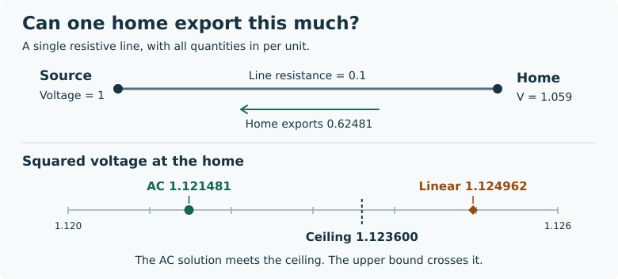

# FlexExport · What one corner of a box can certify

On a sunny afternoon, several homes on the same cable can push power back toward the transformer. **How much can each home export while keeping voltage under the limit?** For the release's 18 new homes, we can prove that a common cap of **2.71964344 kW per home** passes an upper-voltage check for a whole range of conditions. The proof has two parts. A bound covers all the hours between observations. A second calculation tells us exactly how much the bound allows. The actual network can sometimes accept more.

## 1. Where the voltage rises

Work in per-unit coordinates on a balanced tree. Treat power supplied to the network as a positive injection. Let $v_0$ denote squared source voltage magnitude. Index every bus except the source. Set $C_{ie}=1$ if branch $e$ lies between the source and bus $i$, and set it to zero otherwise. The series resistances $r_e$ and reactances $x_e$ give

$$
R=C\operatorname{diag}(r)C^\top,\qquad X=C\operatorname{diag}(x)C^\top .
$$

For two homes, $R_{ij}$ and $X_{ij}$ sum the impedances along the stretch of cable they share. With nonnegative branch parameters the matrices are positive semidefinite and entrywise nonnegative. With positive resistances and **all non-source buses** represented, $C$ is invertible and $R^{-1}$ is the reduced weighted Laplacian with conductances $1/r_e$. A household matrix can repeat a row when two homes share a bus.

**Proposition.** Every AC solution of the balanced, series-only tree with fixed nodal active and reactive injection vectors $p,q$ satisfies

$$
v_i=|V_i|^2 \le \widehat v_i=v_0+2(Rp+Xq)_i.
$$

**Proof.** Orient each edge away from the source. Its sending-end active and reactive flows $P_e,Q_e$ equal minus the downstream injections plus the corresponding downstream series losses, including its own. Write $\ell_e=|I_e|^2$ and $z_e=r_e+\mathrm i x_e$. In the branch voltage step $v_j=v_i-2(r_eP_e+x_eQ_e)+|z_e|^2\ell_e$, the edge's own net loss correction is $-|z_e|^2\ell_e$. Each strict downstream edge $k$ contributes $-2(r_er_k+x_ex_k)\ell_k$. Every correction is nonpositive. Sum along the path to $i$. This argument permits ideal nominal-ratio transformers in compatible per-unit coordinates. Tap changes, multiphase couplings and voltage-dependent loads require their own models. [Gan, Li, Topcu and Low, *Exact Convex Relaxation of Optimal Power Flow in Radial Networks*, Lemma 1](https://smart.caltech.edu/papers/exactconvexrelaxation.pdf)

Over a box of source voltages and injections, the upper corner maximizes every linearized squared voltage. Testing that corner decides exactly whether the **linear bound** stays within the voltage ceiling. Passing gives an AC upper-voltage guarantee under the stated hypotheses. AC existence, branch current and minimum voltage are separate questions. A corner of an enclosing box can introduce extra slack when the operating variables are correlated.

**An exact counterexample to AC completeness.** One resistive line has source magnitude 1, resistance $r=0.1$ and unity-power-factor injection $p=0.62481$. The receiving bus has a high-voltage solution $V=1.059$, since $p=V(V-1)/r$. Its squared voltage is 1.121481, below the ceiling $1.06^2=1.1236$. The linear prediction is 1.124962, above the ceiling. Every smaller injection down to zero on the high-voltage branch also passes the AC limit because $V(V-1)$ increases for $V\ge1$.

**An exact certificate of linear optimality.** A fork has a common resistance of 0.01 and terminal resistances of 0.01 and 0.02. With source magnitude 1, a **squared-voltage** ceiling of 1.06 and unity-power-factor injections $u_1,u_2\ge0$, the two limiting rows become $2u_1+u_2\le3$ and $u_1+3u_2\le3$. The vector $(6/5,3/5)$ meets both with equality. Multiplying the rows by $2/5$ and $1/5$, respectively, and adding them gives $u_1+u_2\le9/5$. The feasible vector attains this value. The two multipliers form a dual certificate that anyone can check by multiplication and addition.

## 2. A voltage certificate for the published feeder

The archived circuit includes cable charging and a transformer core conductance. Treat those shunts as injections at their nodes. Let $B_j^+\ge0$ bound the capacitive susceptance, so charging supplies at most $B_j^+v_j$ in reactive power. Core conductance draws active power and can be dropped conservatively. Assume other net reactive injections at each node are nonpositive. With a componentwise upper bound $\bar X\ge X$, set

$$
H=2\bar X\operatorname{diag}(B^+),\qquad
f=\bar v_0\mathbf 1+2R\bar p,\qquad v\le f+Hv .
$$

Here $\bar v_0$ and $\bar p$ are the upper bounds of the operating box. The program checks that $H\ge0$ and $\lVert H\rVert_\infty<1$. If $f+H(U\mathbf 1)\le U\mathbf 1$, the difference satisfies $(I-H)(v-U\mathbf 1)\le0$. Since $(I-H)^{-1}=\sum_{k\ge0}H^k$ is entrywise nonnegative, every AC solution obeys $v\le U\mathbf 1$.

**Worked box.** The upper source magnitude is 1.02 and the upper bus magnitude is 1.06. The 32 existing homes can simultaneously inject up to their individual PV ratings, totaling 60 kW. Each of the 18 new homes can inject up to a common $t$ kW. All smaller active injections consistent with the model are covered. The proof assumes the published balanced topology and the reactive-power condition above. Positive reactive injections from additional equipment would need their own upper bounds.

Use the published 250 kVA base, nominal 20/0.4 kV transformer, 45 m main cable sections and 30 m lateral sections. Bound the transformer's series reactance $\sqrt{0.06^2-0.0144^2}$ per unit above by 0.058247. Use $22/7$ as an upper bound on $\pi$ in cable charging. Every subsequent inequality uses rational arithmetic.

Let $E_j$ be the existing PV nameplate at node $j$ in kW and $n_j$ the number of new homes there. Then $\bar p_j=(E_j+n_jt)/250$ per unit. Each non-source bus imposes one rational row $a_it\le b_i$ with

$$
a_i=2(Rn)_i/250,\qquad b_i=U\bigl(1-\textstyle\sum_j H_{ij}\bigr)-\bar v_0-2(RE)_i/250 .
$$

The maximum row sum of $H$ is below 0.00001091. All 42 voltage rows pass at

$$
t_*=\frac{574489407223518679}{211237031250000000}\ \mathrm{kW}
\simeq 2.7196434443\ \mathrm{kW}.
$$

The limiting bus is L10.3. Its row coefficient $a_i=193131/10000000$ gives the sole nonzero dual multiplier $10000000/193131$. This certifies the largest equal offer allowed by this sufficient linear screen. A larger offer could still pass an AC analysis. The certificate bounds upper voltage only. Thermal limits, lower voltage and inverter capability require additional checks.

A separate replay in the archive reported seven failing half-hours for a different flexible schedule built from a local training period. Those hours establish specific violations for that schedule. The number of violations outside the observed profiles remains unknown. [Archived model, input generator and replay receipts](https://raw.githubusercontent.com/towre676-cloud/crest-root-calculus/4d311c055d98e8155d6d12d73588f747de034545/downloads/crest_root_three_builds_expanded.zip)

## 3. When a voltage controller overshoots

An inverter can respond to high voltage by absorbing reactive power. An aggressive controller can correct too far, then reverse too far on the next update. To check this locally, use a voltage-**magnitude** model $V=V_b+Xq$ with a specified symmetric positive-semidefinite sensitivity in units consistent with $q$. The conversion from squared voltage is $d|V|=dv/(2|V|)$. Near a flat 1 per-unit point, the commonly used magnitude model can have the common-path sensitivity above. At an arbitrary AC operating point its actual sensitivity and assumptions must be checked.

At a differentiable operating point in fixed control segments, let $f_i(V_i)$ be the commanded reactive power. Set $S=-\operatorname{diag}(f_i')\ge0$ and $K=S^{1/2}XS^{1/2}$. The matrices $SX$ and $K$ have the same characteristic polynomial, including when some slopes vanish, by the product identity for $AB$ and $BA$. Write $\lambda_i$ for the eigenvalues of $K$ and $\lambda_{\max}$ for their maximum.

| Implementation in the stated local model | Modal rate or multiplier | Local exponential stability of the linearization |
| --- | --- | --- |
| Common lag $\tau\dot q=f(V)-q$ with $\tau>0$ | $-(1+\lambda_i)/\tau$ | All rates strictly negative |
| Synchronous update $q_{k+1}=f(V_k)$ | $-\lambda_i$ | $\lambda_{\max}<1$ |
| Relaxed synchronous update $q_{k+1}=(1-\alpha)q_k+\alpha f(V_k)$ | $1-\alpha(1+\lambda_i)$ | $0<\alpha<2/(1+\lambda_{\max})$ |

A multiplier below $-1$ gives an alternating, growing local perturbation. Saturation, segment switching, delay and changing operating points can alter the eventual trajectory. Numerical damping in a fixed-point solver does not by itself establish hardware stability or a curtailment result. [Farivar, Chen and Low, *Equilibrium and Dynamics of Local Voltage Control in Distribution Systems*](https://spot.colorado.edu/~lich1539/papers/Chen-2013-VVC-CDC.pdf)

| Gain supplied in the project draft | Undamped multiplier | Multiplier at $\alpha=0.5$ |
| --- | ---: | ---: |
| 0.477 | −0.477 | 0.2615 |
| 1.256 | −1.256 | −0.128 |

The steep case has critical relaxation $\alpha=125/141\simeq0.8865$. The pinned release does not supply the control curves, their active sets or the reactive capability and base used for those gains. These two rows are therefore **conditional calculations**. The public circuit does independently reproduce the transformer's **46.17%** share of source-to-L10.3 series reactance. Its source-to-end $R/X$ is **1.98886**, with $R=0.25093125$ and $X\simeq0.12616825$ per unit. A ratio of 1.30 would require another path or another parameter set. Zero curtailment for the steep control law remains unverified.

## Reproduce

Run **python check.py --check** in this folder with standard Python. The [receipt](receipt.json) lists all rational witnesses. The [feeder layout](feeder18.csv) records the published location and PV inputs from **home_layout(32, 0.45, 18, 0)** in existing-then-candidate order. All voltage certificates use exact fractions. Displayed impedance ratios use a floating-point square root.

**Cross-check with the archived AC solver.** In the upper-corner case, set every external reactive injection to zero and export every allowed kW. The original solver gives **1.05890316 per unit** at L10.3, its highest bus voltage. It converges in nine iterations with a maximum nodal power mismatch of $3.01\times10^{-14}$ per unit. This checks one operating point independently of the rational proof. To reproduce it, extract the combined research ZIP (or the pinned archive above) and execute the following Python in its **solar_export** directory, with NumPy available.

    import numpy as np
    from flexexport.layout import home_layout
    from flexexport.radial import Feeder

    homes = home_layout(32, 0.45, 18, 0)
    feeder = Feeder(homes)
    cap_kw = 574489407223518679 / 211237031250000000
    demand = np.array([[-cap_kw if home["new"] else -home["pv_kw"] for home in homes]])
    flow = feeder.solve(demand, np.zeros_like(demand), source=1.02)
    peak = int(np.argmax(flow.voltage[0]))
    print(feeder.lv_names[peak], flow.voltage[0, peak], flow.residual, flow.iterations)
