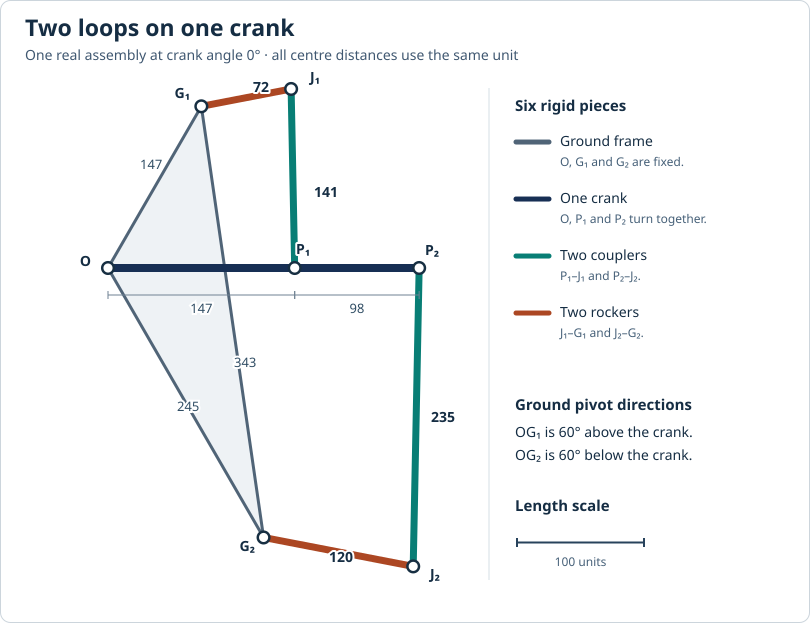

# A six-bar mechanism with a degree-three elliptic map

**Turn one crank and watch two triangles.** Each triangle usually folds in two ways, so the two loops give four possible poses at one crank angle. At special angles a triangle flattens and its two poses meet. Which angles the loops share determines the genus of the configuration curve. One set of integer link dimensions below gives a smooth genus-three plane quartic with an explicit degree-three elliptic map over a number field. Another gives a smooth genus-three plane quartic on which every elliptic map has even degree.

## The mechanism that works

Make the ground and crank each a rigid piece with three pivot centres. They share the crank's axis at the origin. The ground's two other pivots lie on rays at $+60^\circ$ and $-60^\circ$. The crank's two other pins lie at different distances on **one** ray and turn together. Each crank pin drives its own coupler, which connects to a rocker pinned to the ground. This gives six rigid bodies including the ground, with seven revolute joints. The table gives centre-to-centre distances in a common unit.

| Loop | Ground radius | Crank radius | Coupler | Rocker |
|---|---:|---:|---:|---:|
| Ground ray at $+60^\circ$ | 147 | 147 | 141 | 72 |
| Ground ray at $-60^\circ$ | 245 | 245 | 235 | 120 |

The two ground pivots are 343 units apart, by the cosine law. The crank pins are 98 units apart. The loops are copies of $(49,49,47,24)$ scaled by 3 and 5. At crank angle $0^\circ$ each unscaled triangle has sides $47,24,49$, so all four assembly choices are real there. These are ideal planar joints. Clearances and collisions require a separate mechanical model.

### Which angles meet?

Choose $0<\delta<60^\circ$ by $\cos(\delta/2)=47/49$ and $\sqrt3\sin(\delta/2)=24/49$. Thus $d=\cos\delta=2017/2401$. In an unscaled loop the distance from crank pin to rocker pivot is $98|\sin((\theta-\gamma)/2)|$, where $\gamma$ is its ground angle. Its limiting lengths are $47-24=23$ and $47+24=71$. The identity

$$98\sin((60^\circ\pm\delta)/2)=47\pm24$$

puts the common limiting angles at $\pm\delta$. The first loop's other pair is $120^\circ\pm\delta$, and the second's is $-120^\circ\pm\delta$. All six values are distinct.

Use projective half-angle coordinates $[u:v]=[\sin(\theta/2):\cos(\theta/2)]$ and $S=u^2+v^2$. Set $h_0,h_+,h_-$ equal to the homogeneous quadratics $S(\cos(\theta-\gamma)-d)$ for $\gamma=0,120^\circ,-120^\circ$, respectively. For example, $h_0=v^2-u^2-dS$ and $h_\pm=-(v^2-u^2)/2\pm\sqrt3uv-dS$. Direct substitution in Heron's formula gives the two unscaled quartics $-(2\cdot49^2)^2 h_0h_+$ and $-(2\cdot49^2)^2 h_0h_-$. Scaling every length in a loop by $m$ multiplies its quartic by $m^4$.

### A map that puts three configurations at one point

The coordinates of the two fixed ground pivots lie in $\mathbb Q(\sqrt3)$. After adjoining $i=\sqrt{-1}$, the changes $y_j\mapsto i y_j$ turn the two scaled-down physical equations $y_j^2=-h_0h_j$ into $y_j'^2=h_0h_j$, for $j=+,-$. Thus the actual mechanism and the following symmetric curve are isomorphic over **$K=\mathbb Q(\sqrt3,i)$**. The symmetric equation itself has rational coefficients.

On the dense set $h_0\ne0$, take projective coordinates $[X:Y:Z]=[h_0:y'_+:y'_-]$. Their squares are proportional to $[h_0:h_+:h_-]$. The three quadratics are independent since $d\ne0$. Their sum is $-3dS$ and their sum of squares is $(3/2+3d^2)S^2$. The canonical plane quartic is therefore

$$6d^2(X^4+Y^4+Z^4)=(1+2d^2)(X^2+Y^2+Z^2)^2.$$

The six simple branch points give smoothness by the conic criterion below. **Cycling the three coordinates** preserves the equation. Of the three eigenpoints of this order-three permutation, $[1:1:1]$ lies off the curve, while $[1:\omega:\omega^2]$ and $[1:\omega^2:\omega]$ lie on it, where $\omega^2+\omega+1=0$. Riemann–Hurwitz gives $4=3(2g'-2)+2(3-1)$, so the quotient has genus one.

Here are formulas for the map. Write $s_1=X+Y+Z$, $s_2=XY+YZ+ZX$, $s_3=XYZ$. On $s_1\ne0$ set

$$U=\frac{s_2}{s_1^2},\qquad W=\frac{s_3}{s_1^3},\qquad V=\frac{(X-Y)(Y-Z)(Z-X)}{s_1^3}.$$

The target coordinates are $(U,V)$. Eliminate $W$ using

$$W=\frac{(1+2d^2)(1-2U)^2-6d^2(1-4U+2U^2)}{24d^2}.$$

The cubic discriminant gives the target equation

$$V^2=U^2-4U^3-4W-27W^2+18UW.$$

Indeed, $X/s_1,Y/s_1,Z/s_1$ are the roots of $T^3-T^2+UT-W$. Generically six orderings give the same $(U,W)$, and the sign of the Vandermonde product leaves three for a given $V$. Thus the map has degree exactly three and extends between the smooth projective curves. On the quotient $U=1/2$ gives $W=1/8$ and $V^2=-3/64$. Taking $V=\sqrt{-3}/8$ supplies a point over $K$ to choose as origin. **This proves an elliptic target for the physical linkage over $K$.** The displayed rational form has a genus-one quotient over $\mathbb Q$. There is a concrete obstruction to real descent of this particular quotient. Under our coordinates, complex conjugation on the physical curve becomes ordinary conjugation followed by $D=\operatorname{diag}(1,-1,-1)$ on the symmetric quartic. For $S(X,Y,Z)=(Y,Z,X)$, the conjugate $DSD$ acts by $(-Y,Z,-X)$. It is neither $S$ nor $S^2$ projectively. Consequently conjugation takes the cyclic deck subgroup to a different subgroup. Its invariant function field cannot be the pullback of a target over $\mathbb R$ on the physical form. Other candidate degree-three maps on that real form would need their own descent analysis.

As an arithmetic check, the script evaluates the map at every rational point of the smooth symmetric quartic over four finite fields. In the chart $s_1\ne0$ it finds 18, 14, 10 and 30 distinct images at primes 31, 37, 43 and 61. Every attained image has exactly three rational preimages. The characteristic-zero argument above establishes the degree globally, including points omitted by that chart.

## Why two shared angles give genus three

Start with two smooth loop covers of one angle line $\mathbb P^1$ in characteristic zero. Each has four simple geometric branch values. Assume that their squareclasses are distinct and nontrivial, so the combined function field is biquadratic. Use the smooth projective normalization of the fibre product. At a shared branch value the two equations in the raw fibre product have a singular point. Normalization distinguishes the branches there.

If the two branch sets meet in $r$ values, their union has $8-r$ values. At each value the inertia group has order two over the algebraic closure. Riemann–Hurwitz for the degree-four cover gives $2g-2=-8+2(8-r)$, hence **$g=5-r$**. With $r=2$, write the two quartics $AB,AC$, retaining their constants, where $A,B,C$ are squarefree binary quadratics with pairwise disjoint roots. The three genus-one quotients have equations

$$y_1^2=AB,\qquad y_2^2=AC,\qquad y_3^2=BC,\qquad y_3=y_1y_2/A.$$

The pullbacks of their regular differentials are independent because they belong to three distinct sign characters. They span the three-dimensional space of differentials. Consequently the product of their Jacobians is isogenous to the Jacobian of the configuration curve, over the coefficient field. The three sign quotients each have degree two. The degree-three map in the worked design comes from an **additional cyclic symmetry**. It permutes the three sign involutions, so their three degree-two quotients are geometrically isomorphic. In the final example the three elliptic factors can be distinguished by point counts, which makes this symmetry impossible.

### A test for the plane-quartic model

On an affine base with coordinate $t$, multiply $[dt/y_1:dt/y_2:dt/y_3]$ by $y_1y_2/dt$. This gives the canonical map $[X:Y:Z]=[y_2:y_1:A]$, with coordinate squares proportional to $[C:B:A]$.

| Test on $A,B,C$ | Canonical image | Reason |
|---|---|---|
| Three independent quadratics | Smooth plane quartic | The triple parametrizes a nonsingular conic in the squared coordinates. From a generic point on that conic one recovers $t$ uniquely. The signs of $X,Y,Z$, modulo overall sign, distinguish the four poses. |
| Linearly dependent quadratics | Conic covered twice | A linear relation on $C,B,A$ gives a diagonal conic equation on $X,Y,Z$. Its coefficients are nonzero by disjointness of roots. |

In the first case, squarefreeness makes the conic meet each coordinate axis transversely, and disjointness keeps it away from the coordinate vertices. Pulling back by coordinatewise squaring therefore gives a smooth quartic. In the aligned, even-quartic construction all three common and private pairs are invariant under $t\mapsto-t$ and comprise opposite roots. Their quadratics belong to the two-dimensional span of $u^2,v^2$. The resulting genus-three curve is **hyperelliptic**. A ground-axis offset can change this conclusion.

For an aligned arithmetic control take $(g,a,b,c)=(6,4,6,2)$ and $(6,4,7,1)$ with the same ground axis. The quadratics are $A=5v^2-3u^2$, $B=7u^2-v^2$, $C=6(2u^2-v^2)$. The raw Heron forms are $12^2AB$ and $8^2AC$. At $p=13$ the normalized curve has 24, 204 and 2,040 points over extensions of degrees one, two and three.

## A plane quartic with a proven obstruction

Take a crank pin at radius 28 and two independent rocker pivots at $(0,21)$ and $(8,15)$; the coupler and rocker lengths are $(24,11)$ and $(32,7)$. Both couplers can meet the same crank pin as a ternary joint. Using the same half-angle parametrization gives

$$A=uv,\quad B=22(u^2+v^2)-49uv,\quad C=120u^2-161uv-120v^2.$$

The raw Heron forms are $336^2AB$ and $112^2AC$. At $u/v=2$, both products are positive. The determinant of the coefficient rows in $(u^2,uv,v^2)$ is 5280. Each quadratic has distinct roots and their pairwise resultants are $484,-14400,5849764$. The smooth canonical quartic over $\mathbb Q$ is

$$\left(\frac{Y^2+49Z^2}{22}\right)^2-\left(\frac{X^2+161Z^2}{120}\right)^2=4Z^4.$$

Here $E_1,E_2,E_3$ denote the Jacobians of the $AB,AC,BC$ quotients, respectively. Counts of the three double covers give their traces in that order.

| Prime $p$ | Traces $(a_1,a_2,a_3)$ | $\#C(\mathbb F_p)$ | $\#C(\mathbb F_{p^2})$ | $\#C(\mathbb F_{p^3})$ |
|---|---|---:|---:|---:|
| 7 | $(0,0,0)$ | 8 | 92 | 344 |
| 13 | $(2,-2,-6)$ | 20 | 204 | 2,180 |
| 23 | $(-4,0,0)$ | 28 | — | — |
| 71 | $(8,0,-4)$ | 68 | — | — |

At 23 the first elliptic factor is ordinary and the other two are supersingular. At 71 the second is supersingular and the third is ordinary. These two good primes distinguish every pair. An isogeny over $\overline{\mathbb Q}$ would specialize to an isogeny over the algebraic closure of each residue field, which preserves ordinarity. Thus the three factors are **pairwise geometrically nonisogenous**.

For any nonconstant map $f:C\to E$ to an elliptic curve over $\overline{\mathbb Q}$, the induced Jacobian homomorphism can use only one of these three factors. The deck involution of the corresponding degree-two quotient therefore fixes the differential $f^*\eta$, for a nonzero invariant differential $\eta$ on $E$. The difference $f\circ\iota-f$ has zero differential and is constant in characteristic zero. The involution has four fixed points by Riemann–Hurwitz. Evaluation at one gives constant zero. Hence $f$ factors through the degree-two quotient, and **its degree is even**.

The verifier counts both the quartic and the normalized angle fibres independently. At a zero of $A$ the rational fibre size is the number of square roots of $BC$. For example at $p=7$, the shared angle $u/v=0$ contributes zero rational poses and the shared angle at infinity contributes two. The script obtains the complete degree-six Frobenius polynomial by Newton identities and reciprocity at $p=7,13$ and compares it with $\prod_i(1-a_iT+pT^2)$.

## Replay

From this directory run `python3 check.py`. The Python standard library is sufficient. The program prints its deterministic JSON results. Compare them with [the recorded calculations](receipt.json). The [drawing generator](draw.py) intersects the two bar-length circles in each loop and checks their distances before drawing the assembly. The verifier includes exact polynomial identities for the linkage dimensions and the symmetric quartic, projective point counts, and the cyclic quotient chart. [Read the verification code](check.py).

For the more general theory of split Jacobians in genus three, see Everett Howe, Franck Leprévost and Bjorn Poonen, [*Large torsion subgroups of split Jacobians of curves of genus two or three*](https://math.mit.edu/~poonen/papers/large.pdf).
