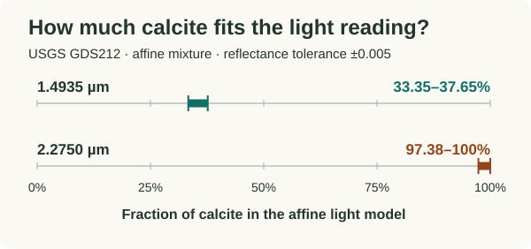

# GeoAssay · What can light tell us about a weighed powder?

A lab can mix eight grams of calcite with two grams of clay. A spectrometer sees the surfaces the light reaches. If one powder has smaller grains, the same weight presents more surface. **Which fraction can you learn from the light?** The answer depends on the mixing model and which properties of the reference grains you know.

## 1. A measured two-band exclusion

Start with the affine model for two reference spectra. At wavelength $\lambda$, predict $B_\lambda+f(A_\lambda-B_\lambda)$ with a single fraction $0\le f\le1$. A measurement $y_\lambda$ with absolute tolerance $\varepsilon$ allows a closed interval $I_\lambda$ of fractions. Divide the inequalities $y_\lambda-\varepsilon\le B_\lambda+f(A_\lambda-B_\lambda)\le y_\lambda+\varepsilon$ by the slope, sort the endpoints, and intersect with $[0,1]$. A flat band allows every fraction or rules out the model by itself.

**Proposition.** On a finite table of bands, the complete feasible set is their interval intersection. If all individual intervals are nonempty, take the largest lower endpoint and smallest upper endpoint. A strict reversal gives a two-band exclusion. Equality gives a possible fraction. For a fixed list of $k$ endmembers the weights live in a simplex of dimension $k-1$. Each band's feasible set is a convex slab clipped to that simplex. Helly’s theorem gives a witness of at most $k$ bands for infeasibility. The same bound need not apply when the optical parameters enter nonlinearly.



| Physical USGS specimen | First wavelength and permitted calcite fraction | Second wavelength and permitted calcite fraction |
| --- | --- | --- |
| GDS212, calcite + montmorillonite | 1.4935 µm · 33.35–37.65% | 2.2750 µm · 97.38–100% |
| GDS213, calcite + kaolinite | 1.4185 µm · 0–4.01% | 2.4960 µm · 54.73–62.34% |

Fractions above are rounded for reading. The checker uses exact fractions on six-decimal native-channel data at $\varepsilon=0.005$. For GDS212 the two upper/lower endpoints in conflict are $87694/232939$ and $98597/101253$. Each wavelength alone admits a mixture. Together they reject that affine model for the named reference specimens. **The lab actually weighed 80% calcite into each powder.** An exclusion diagnoses the fit of the optical model. It cannot erase a mineral that the lab mixed in. GDS213 uses KGa-1 as the available kaolinite reference for the CM9 clay in the actual mixture. [Native channels and source checksums](bands.json) · [USGS GDS212](https://pubs.usgs.gov/of/2003/ofr-03-395/DESCRIPT/S/calcite_mixture_gds212.html) · [USGS GDS213](https://pubs.usgs.gov/of/2003/ofr-03-395/DESCRIPT/S/calcite_mixture_gds213.html)

The bound of three can be attained for three endmembers. Let each band read a different simplex coordinate and allow the interval $[0.35,0.45]$. Any two bands are satisfied by a permutation of $(0.35,0.35,0.30)$. All three would require weights summing to at least $1.05$.

## 2. Grain size and the weak-absorption fibre

**Model.** For an idealized equivalent slab with fixed external and internal reflection coefficients $0\le S_e,S_i<1$, no internal scattering and optical path $z$, use

$$
W(z)=S_e+(1-S_e)(1-S_i)\frac{e^{-z}}{1-S_i e^{-z}}.
$$

In this convention $W_0=1$, $W_1=(1-S_e)/(1-S_i)$ and $W_2=(1-S_e)(1+S_i)/(1-S_i)^2$ in the expansion $W(z)=W_0-W_1z+W_2z^2/2+O(z^3)$. These constants belong to the specified optical model. [Hapke, *Bidirectional reflectance spectroscopy: 1. Theory*](https://doi.org/10.1029/JB086iB04p03039) · [Equivalent-slab application and assumptions](https://doi.org/10.1029/2020JE006691)

Let $x$ be the optical cross-section fraction of mineral $a$. Its grain-size scale $s_a$ is its effective diameter divided by the corresponding reference diameter. Give mineral $b$ the complementary fraction and its own scale. Set $u=xs_a$, $v=(1-x)s_b$ and write weak absorption profiles as $\kappa_i=\eta k_i$. For an interior mixture and bounded profiles, expanding band by band gives

$$
w=1-\eta W_1(uk_a+vk_b)+\frac{\eta^2W_2}{2}
\left(\frac{u^2 k_a^2}{x}+\frac{v^2 k_b^2}{1-x}\right)+O(\eta^3).
$$

**Proposition.** If the two band profiles are linearly independent, the first-order observations determine $u,v$ and have rank two. Any $0<x<1$ allowed by the grain-size bounds can give the same first-order signal by taking $s_a=u/x$ and $s_b=v/(1-x)$. This is the fibre of the first-order map. The exact nonlinear map can distinguish points on it.

If cross section is proportional to $m_i/(\rho_i D_i)$ under a common shape factor, and $D_i=s_iD_{i0}$, then

$$
\frac{m_a}{m_b}=\frac{\rho_aD_{a0}}{\rho_bD_{b0}}\frac{u}{v}.
$$

**The mass ratio stays fixed along this fibre if the density and reference-size ratio are known.** In the checker, the illustrative ratio $\rho_aD_{a0}/(\rho_bD_{b0})=2$ and $u/v=1/2$ give half the mass in mineral $a$ at optical shares 25%, 40% and 60%. Changing the reference-size calibration changes that inference. A sieve interval supplies a range of possible diameters. Shape-dependent optical paths or specimen mismatch can add further uncertainty.

## 3. Which measurement determines the information exponent?

At fixed $u,v$, the first $x$-dependent albedo derivative is

$$
\partial_x w=\frac{\eta^2 W_2}{2}
\left(-\frac{u^2 k_a^2}{x^2}+\frac{v^2 k_b^2}{(1-x)^2}\right)+O(\eta^3).
$$

For fixed-variance independent Gaussian **albedo** noise, Fisher information is a squared derivative weighted by the inverse noise variance. When estimating $u,v$ too, first project the $x$ derivative off their two score columns. A nonzero leading projected term gives information of order $\eta^4$.

For fixed variance in the **reflectance** $r_0(w)=(1-\sqrt{1-w})/(1+\sqrt{1-w})$, the derivative is $1/[\sqrt{1-w}(1+\sqrt{1-w})^2]$. On bands where the first-order loss is positive and $w\to1$, the derivative grows as $\eta^{-1/2}$. This gives a reflectance score of order $\eta^{3/2}$ and, under the same noncancellation condition, information of order $\eta^3$. A smooth observation channel with bounded, nonzero derivative at the limiting albedo preserves the fourth-power result. A fixed noise variance in one channel generally becomes a varying variance after transformation. [Diffuse reflectance convention, NASA Planetary Spectrum Generator handbook](https://psg.gsfc.nasa.gov/images/help/handbook.pdf)

The decimal-arithmetic experiment uses five specified synthetic bands, estimates the two nuisance directions, and reduces all absorptions by factors of ten. Between $10^{-5}$ and $10^{-6}$ the observed information exponents are **3.999993** for albedo and **2.996956** for reflectance. A maximum absorption depth alone cannot determine which real mixture a given noisy instrument resolves. [Full numerical receipt](receipt.json)

## 4. What to send with a lab request

Record the reference specimen identifiers, densities, grain-size ranges, noise units and the forward model used. Propagate plausible effective reference diameters through the mass-ratio formula. Ask for a targeted grain-size or abundance measurement when the remaining interval would change the decision.

The proposed noiseless mass fractions 0.5356 and 0.5075 refer to model inputs if used as truth. The independent physical labels are both 0.80. The pinned public release provides the physical spectra and the affine benchmark. It lacks the later nonlinear fit files needed to reproduce the reported mass-error value of 0.323, the four profile widths, or an attribution of that error to individual causes.

Run the [checker](check.py) with Python 3.11+:

```sh
python check.py --check
# Optional, from this folder inside the combined research ZIP
python check.py --check --source ../../../assay_selector/data
```
