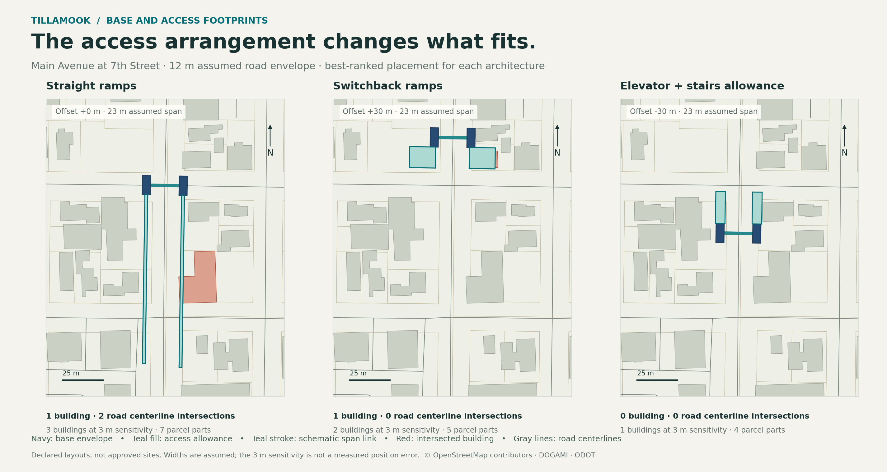

# Tillamook deployable crossing — version 2

**A mapped engineering test bed for two mobile half-spans that meet above a road.** This release uses the saved Tillamook Atlas V5, adds an exact 2D/3D truss solver, checks complete declared support trajectories and connector transforms, and compares roadside placement hypotheses. It is research software with verified model results; no site or physical bridge is approved.

**Start with `workbench.html`.** Extract the ZIP and double-click that file, or use `Open-Workbench.cmd` on Windows. The map, alternatives and recorded calculations work offline without Python or a web server. Python 3.11 or later replays the calculations with the standard library. Optional SymPy and GDAL checks are separate.

- [Download the complete v2 packet](https://github.com/towre676-cloud/crest-root-calculus/raw/refs/heads/main/downloads/crest-root-tillamook-crossing-v2-2026-11-23.zip)
- [Engineering decisions and remaining work](design-review.md)
- [Exact structural mechanics](mechanics.md)
- [Support-path and connector proofs](engineering-proof.md)
- [Oregon design basis and sources](oregon-design-basis.md)
- [Atlas evidence audit](atlas-audit.md)
- [Official hazard data and provenance](data/hazards/README.md)

## The strongest findings

| Question | Result | Practical meaning |
|---|---|---|
| Can our saved mapping drive the study? | Yes: six real junctions, 395 building footprints, 401 parcel parts and a 2 m terrain crop are extracted reproducibly. | We can screen actual mapped layouts and retain source IDs. |
| Does the map establish the span? | No: all 244 selected path widths are authored. | Width hypotheses remain explicit until a road/shoulder survey replaces them. |
| Do the first roadside arrangements fit? | 636 of 648 layouts intersect a building or vehicle centerline. The remaining 12 all have a building within the separate 3 m sensitivity. | Accessible approaches and base space govern the next design iteration. This is a finite sweep, not a proof that Tillamook has no possible site. |
| Can the program analyze trusses now? | Yes: exact displacements, axial forces/stresses, reactions, rank and mechanism witnesses for declared rational-length 2D/3D models. | It has a useful analysis kernel; complete spatial bridge design and capacity remain separate work. |
| Can it test intermediate extension states? | Yes, for declared constant-weight/quadratic-position quasi-static paths. | It catches a supplied case whose endpoints pass but middle state fails. Real motion, dynamics and failure states still need models. |
| Can it compare support configurations? | 198 discrete hypotheses checked; 182 satisfy strict vertical-contact feasibility in the stated model. | Six model-specific nondominated tradeoffs are retained, with no inferred ground or material capacity. |
| Can it distinguish a visually aligned seam from connector capture? | Yes: exact finite rotation/translation is checked at every specified connector. | Engagement, structural load transfer and lock verification still require design and tests. |

The spatial findings were independently reproduced with GDAL/GEOS across **5,184 hit sets**, with zero mismatches. The mathematical examples were independently checked using analytic solutions, normalized-direction stiffness assembly, determinant solves, method of sections and unit-load virtual work. See the `verification-*.json` receipts.



## Run and reproduce

From this directory:

```bash
python -S verify_release.py
python -S verify_release.py --recompute-sites
python -S truss.py examples/service-24m-plane.json
python -S engineering_study.py
python -S site_study.py
python build_viewer.py
```

The default release verifier checks the exact solver, bridge controls, bounded engineering screens, source subset and stored-report consistency. `--recompute-sites` additionally regenerates all 648 placement scenarios and compares them to the shipped report. Recomputing reports does not change physical evidence or approve a site.

Optional independent checks:

```bash
python verify_truss.py --symbolic
/usr/bin/python3 verify_site_independent.py
/usr/bin/python3 hazard_screen.py
```

The second and third commands require a Python installation with GDAL's `osgeo` bindings. The shipped hazard report and workbench do not require GDAL. `python -S hazard_screen.py --check` verifies the offline report's bound inputs without those bindings.

To rebuild the subset from the original, extracted **Tillamook-Atlas-V5-Staging.zip**:

```bash
python -S atlas_adapter.py /path/to/atlas-v5 --output /tmp/atlas-subset.json
```

The adapter checks the pinned manifest and all 707 listed files. It does not alter the source Atlas or the Ash & Aether game. A current Site deployment was not substituted for the recovered V5 source.

## Read the models separately

The mapped placements use assumed 8/12/16 m road envelopes and 19/23/27 m base-center spans. The support-path challenge uses the corresponding 9.5/11.5/13.5 m half-reach hypotheses with its own explicit weights and forces. The 24 m service truss and 12 m cantilever examples are synthetic rational-geometry controls with different load assumptions. They are not one consistently designed machine. Integrating real masses, geometry, connections, bearings and access into one checked spatial model is a stated next milestone.

The reported geometric half reach runs from a base center to the midpoint. Additional connector engagement length, bearing offsets and transport clearances depend on the physical design and are not included in that value.

Exact arithmetic removes floating-point ambiguity from the supported algebra. It does not remove uncertainty in GIS, loads, stiffness, workmanship, soil or operating conditions. General rational-coordinate trusses can have irrational member lengths; the current stdlib solver rejects those rather than silently rounding them. GIS predicates and terrain interpolation use conventional floating-point arithmetic, with a separate independent geometry-engine review.

## Data, sources and archive identity

The original V5 ZIP SHA-256 is `90f06d6f8bd4a67e51350f2ae849a1f16440925493c1ab2b7111241f1e1f79a8`. The retained downtown data has its own content and byte hashes. Official FEMA/DOGAMI source responses were captured on **23 November 2026 Eastern time** (24 November UTC); queries, response hashes, ID-completeness controls and clipping provenance are retained. Retrieval failures and the successful smaller-batch recovery remain in the record.

OpenStreetMap-derived database content is **© OpenStreetMap contributors**, redistributed under **ODbL 1.0**. Other layers retain their individual source attribution and scope. [Data notices](data/NOTICE.md). The archive manifest verifies file identity, not engineering validity.

This version is additive. The [preceding feasibility study](https://github.com/towre676-cloud/crest-root-calculus/tree/main/research/deployable-crossing) and frozen PARI comparisons remain intact. No new PARI/GP speed claim is made by this release.
