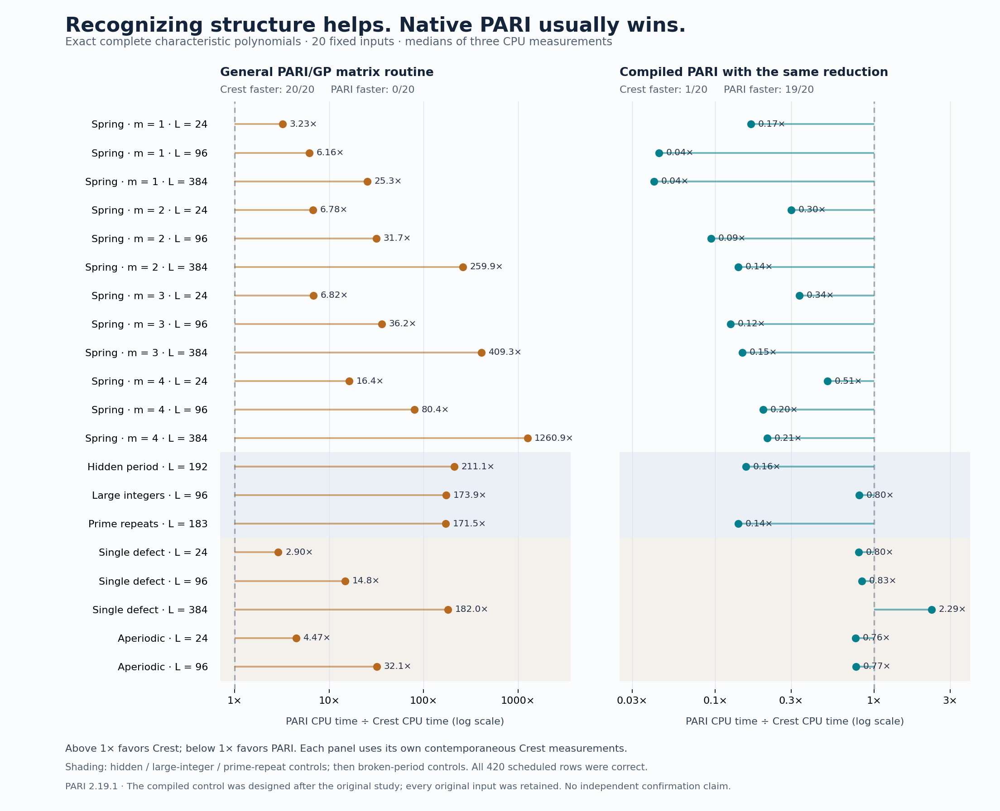

# Periodic spectra: what we can and cannot beat

**23 November 2026.** A complete, exact spectral task connects the project's character and curve methods to a concrete materials model: an integer spring ring with a repeated unit cell. The result is useful, but the strongest comparison favors PARI.

**Measured conclusion.** The new Crest C++ implementation beats PARI/GP's general matrix `charpoly` route on all 20 inputs, with a median ratio of 31.893 in its favor. Once PARI receives the same reduction and runs as compiled C using its native polynomial kernels, PARI wins 19 of 20 inputs and all 12 periodic spring inputs. This is evidence for recognizing structure, and against claiming that this implementation outperforms PARI's exact arithmetic in general. Exact arithmetic is a capability of both systems.

| Comparison | Correct inputs | Crest CPU wins | PARI CPU wins | Median PARI CPU / Crest CPU |
|---|---:|---:|---:|---:|
| Original: GP general matrix `charpoly` | 20/20 | 20 | 0 | 31.893 |
| Original: GP periodic linear recurrence | 20/20 | 20 | 0 | 2.295 |
| Original: GP periodic binary powering | 20/20 | 10 | 10 | 1.064 |
| Separate compiled control: native PARI linear | 20/20 | 7 | 13 | 0.800 |
| Separate compiled control: native PARI binary powering | 20/20 | 1 | 19 | 0.206 |

The ratios use each input's median of three repeated measurements; values above one favor Crest. The compiled control reruns Crest contemporaneously and preserves the entire original panel. It was designed **after** observing the first comparison to address the native-language versus GP-language confound. It is not an independent confirmation sample. All 420 scheduled rows are correct; all 1,331 cold and batch observations, including calibration attempts, are retained. There are no timeouts or wrong outputs in these two studies.



[Original GP study](results.md) · [Compiled PARI study](native-results.md) · [Application assessment and next challenge](opportunities.md) · [Proof](proof.md) · [Spectral curves](spectral-curve.md)

## What the program computes

The input describes a real symmetric cyclic tridiagonal matrix with integer diagonal entries, nonzero signed integer bonds and at least three sites. The output is the **entire integer characteristic polynomial**, with all coefficients and multiplicities. Approximate eigenvalues, a few traces, a factorization and a numerical stability decision would be different output contracts.

For a physical spring example with identical unit masses, let the bond stiffnesses be positive integers $k_i$ and the pinning constants be nonnegative integers $p_i$. Set

$$
a_i=k_{i-1}+k_i+p_i,\qquad b_i=-k_i.
$$

The matrix is the Hessian of

$$
E(u)=\frac12\sum_i k_i(u_{i+1}-u_i)^2+\frac12\sum_i p_i u_i^2.
$$

This is a one-dimensional harmonic model. It supplies no first-principles force constants, molecular structures, drug predictions or general crystal-space-group solver.

The implementation validates the input and finds the least **joint** period of its diagonal and bonds. It does not trust the declared cell length. A defect is retained exactly and can increase the actual period to the full ring length. The supplied matrix recognizer also rejects off-cycle couplings and nonsymmetric matrices; those matrix-format checks are separate from the common expanded-array timing contract.

For a detected cell of length $m$ repeated $N$ times, define

$$
C_j(x)=\begin{pmatrix}x-a_j&-b_{j-1}\\b_j&0\end{pmatrix},\quad
B=\prod_j b_j,\quad D(x)=\operatorname{tr}(C_{m-1}\cdots C_0).
$$

Then

$$
R_0=2,\quad R_1=D,\quad R_n=DR_{n-1}-B^2R_{n-2},\qquad
\boxed{\chi_A(x)=R_N-2B^N.}
$$

The signed product $B$ matters. This is classical Floquet/Chebyshev mathematics, with a self-contained multiplicity-preserving proof in [proof.md](proof.md). It is not presented as a new theorem. The distinct test is whether a useful structure can be recognized, applied and independently certified under a fair comparison.

## Run the exact example and verify the evidence

From the repository root, or the top directory of either downloadable packet:

```sh
python research/periodic-spectra/model.py research/periodic-spectra/example.json
python -m pip install "sympy>=1.12,<2"
python research/periodic-spectra/audit_native.py
```

The solver itself uses Python's standard library. SymPy is needed for the independent symbolic controls. On Windows, `py` may replace `python`. No PARI installation, C++ compiler or benchmark binary is needed to check the archived mathematical outputs and timing receipts.

The example has cell diagonal $(3,7,7)$, bonds $(-1,-4,-2)$ and four repetitions. It has 12 sites, detected period three,

$$
D=x^3-17x^2+70x-64,\qquad B=-8,
$$

and the program returns the complete degree-12 polynomial. Coefficients in JSON are in **ascending** order: constant coefficient first. Change `repeats` or supply full arrays with `repeats: 1`; the actual period is discovered again.

The verifier independently rebuilds every main-panel polynomial using the full-ring continuant identity, without repeated-cell compression. It also checks 33 separate model cases, including 17 direct symbolic determinants and 16 symbolic characteristic polynomials; rejects 33 altered outputs and nine malformed matrices; and checks six spring-energy controls. Twelve formal polynomial identities and five spectral-curve examples verify the normalization companion. Tampered benchmark receipts are rejected. The audit checks schedule completeness, source/protocol/reference hashes, output hashes, period metadata, clock floors and the relation between cold observations, calibration batches and final row status. It cannot authenticate past hardware execution from a JSON receipt; reproducing the timings is a separate experiment.

## Why the strongest baseline changes the answer

The panel contains 12 periodic spring models (cell lengths one through four, total sizes 24, 96 and 384), three structural controls, and five inputs with a broken or absent shorter period. It includes a hidden three-site period, large coefficients, signed bonds and a prime number of repeated cells. The broken-period controls still have cyclic tridiagonal structure; they are not arbitrary dense matrices.

The original four-way comparison uses the latest official PARI/GP **2.19.1**, built from the checksum-verified release source with GMP 6.3.0. Its default integer-matrix `charpoly` is an optimized modular/Hessenberg reconstruction baseline. It also receives two explicit structure-aware GP implementations. Native PARI then receives the same reduction through compiled C, using integer-polynomial kernels such as `ZX_mul` and `ZX_sqr`.

For the 384-site uniform ring, the separate compiled control records **5.1754 ms** for the Crest solver and **0.2134 ms** for native PARI with binary powering: approximately 24.3 times faster for PARI. The only Crest win against this comparator is the 384-site single-defect control: **11.6267 ms** against **26.6334 ms**, approximately 2.29 times faster for Crest. One success on a long nonperiodic continuant is a specific implementation lead to investigate, not a demonstrated domain-wide advantage.

All methods receive the same expanded integer arrays. Every timed iteration repeats validation, period discovery and polynomial computation; no answer is cached. The dense method includes building its matrix, so this comparison measures the full task from the common array input, not just the final `charpoly` kernel. Kernel process CPU excludes parsing, initialization and serialization; separate fresh-process wall and CPU observations include them. Batches run for at least 100 ms. The original GP timer has millisecond resolution; the native clocks use `CLOCK_PROCESS_CPUTIME_ID`. Runs are serial, pinned to one available CPU, with the same 15-second invocation limit and four-GiB address-space limit.

Cold-process ratios are reported separately. They do not establish a faster arithmetic kernel, and their startup advantage must not be substituted for the unfavorable native CPU result. Three repetitions on one machine and a small deterministic panel establish these observations, not statistical confidence across all hardware or an asymptotic optimality theorem.

## The connection to the existing curve work

The Bloch spectral curve is

$$
Y^2=D(x)^2-4B^2.
$$

Repeating the cell gives an exact identity

$$
R_N^2-4B^{2N}=S_{N-1}^2(D^2-4B^2),
$$

where $S_{-1}=0$, $S_0=1$ and $S_n=DS_{n-1}-B^2S_{n-2}$. The repeated equation therefore has the **same smooth normalization**, after removing any pre-existing square factors as well. For the three-site cell above, five repetitions yield a degree-30 plane radicand whose normalization still has genus two. A closed-gap control normalizes to genus zero.

These are degree-one birational identifications of the normalized curves. They are not newly discovered higher-degree quotient maps or Jacobian isogenies. The finite ring's characteristic polynomial is also different from the periodic-times-antiperiodic radicand defining this spectral curve. [Identity, maps and verified examples](spectral-curve.md)

This distinction gives the next challenge a precise target: **discover and certify useful quotient structure from expanded coefficients when the generating metadata is unavailable**. Generic square-factor removal is a baseline, not a victory. Compare genuine higher-degree map recovery against corrected classical decomposition and the project's existing exact map algorithms. Include perturbed and indecomposable controls, exact original-equation certificates, and the total discovery-plus-solve cost. The [application note](opportunities.md) also specifies a rational Brusselator reaction-diffusion stability challenge with an exact instability interval $(1/5,1/4)$; that chemical task is proposed, not implemented or benchmarked here.

The evidence supports a practical architecture: use the project for recognition, reductions, map discovery and verifiable certificates; use strong existing arithmetic kernels where they win. A general claim about lattice reduction, molecular enumeration or chemistry remains unproved.

## Reproduce the timed experiments

Timing requires a POSIX environment, a C++17 compiler with GMP development libraries, and PARI/GP 2.19.1. Build the Crest executable from the repository root:

```sh
g++ -O3 -std=c++17 research/periodic-spectra/solver.cpp -lgmpxx -lgmp -o /tmp/crest-periodic-solver
```

The official PARI source URL, checksum, configuration and observed version are in [pari-build.json](pari-build.json). Build its GP executable and static library, then adapt the include/library paths in the exact command recorded in [pari-native-build.json](pari-native-build.json). An installed compatible PARI development library can also compile `pari_native.c`, but that is a different build and must have its own provenance.

Choose an available CPU number and new output filenames; the runners refuse to overwrite a recorded study:

```sh
python research/periodic-spectra/benchmark.py --gp /path/to/gp --native /tmp/crest-periodic-solver --cpu 0 --output /tmp/periodic-replication.json
python research/periodic-spectra/supplement.py --crest /tmp/crest-periodic-solver --pari-native /tmp/crest-pari-native --cpu 0 --output /tmp/periodic-native-replication.json
```

The second runner retains the archived original study and reference as its provenance while creating a new compiled-control protocol and observations. To audit the first replication, use `audit.py --results /tmp/periodic-replication.json`; the default `audit_native.py` checks the published original and supplemental files. Changing a timed algorithm requires a new study. Do not update frozen source hashes to make old measurements appear to cover new code.

## Files and primary references

| Files | Purpose |
|---|---|
| `model.py`, `example.json` | Portable exact solver, recognizer and example |
| `solver.cpp`, `pari.gp`, `pari_native.c` | Every timed implementation, including PARI comparators |
| `proof.md`, `spectral-curve.md`, `spectral_curve.py` | Proof, normalization maps and symbolic replay |
| `panel.py`, `panel.json` | Deterministic input construction and frozen panel |
| `benchmark.py`, `supplement.py` | Original runner and separately frozen compiled control |
| `results*.json`, `native-results*.json` | Full outputs, protocols, schedules and raw observations |
| `audit.py`, `audit_native.py`, `verify.py`, `verification*.json` | Independent mathematical checks and receipt audits |
| `report.py`, `report_native.py`, `summary.json`, `native-summary.json` | Reproducible tables and summaries |
| `plot.py`, `comparison.png`, `comparison.svg` | Comparison figure generated from both summaries |
| `opportunities.md` | Assessment of all requested application areas and next challenge |

- [PARI/GP official download and source checksum](https://pari.math.u-bordeaux.fr/download.html).
- [PARI/GP linear algebra and `charpoly` documentation](https://pari.math.u-bordeaux.fr/dochtml/html/Linear_algebra__Vectors__matrices_and_sets.html#charpoly).
- [Teschl, *Jacobi Operators and Completely Integrable Nonlinear Lattices*, Chapter 7](https://www.mat.univie.ac.at/~gerald/ftp/book-jac/jacop.pdf).
- [Aghaei, Dayal and Elliott, symmetry-adapted phonon analysis](https://doi.org/10.1016/j.jmps.2012.09.008).

The synthetic fixtures and measured timings here are our experiment. The cited physical and mathematical literature motivates the model; it does not validate these performance measurements or imply application-scale predictive accuracy.
